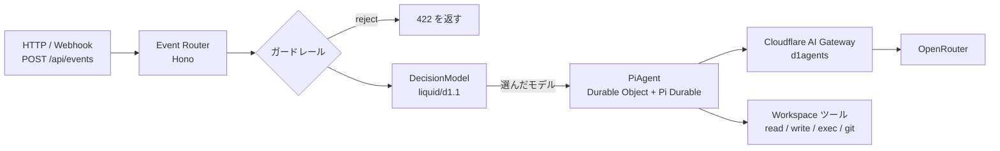

# D1Agents: Pi Durable Agent on Cloudflare

Cloudflare Agents SDK の `PiHarness`（Pi Durable）を Workers + Durable Objects で動かすエージェントです。ブラウザ UI はなく、HTTP API だけで使います。
すべてのリクエストは **Event Router（Hono）** から入ります。**DecisionModel（Liquid d1.1）** が依頼の内容に合う実行モデルを選び、**Pi Durable Agent** がそのモデルで答えます。モデルはすべて OpenRouter のものを Cloudflare AI Gateway 経由で呼びます。

- デプロイ先: https://d1agents-pi-durable.itumens.workers.dev
- 元にしたサンプル: [cloudflare/agents `examples/next/harnesses/pi`](https://github.com/cloudflare/agents/tree/main/examples/next/harnesses/pi)
- ドキュメント: [Pi harness](https://developers.cloudflare.com/agents/harnesses/pi/)

<picture>
  <source media="(prefers-color-scheme: dark)" srcset="docs/architecture/current-dark.png">
  
</picture>

現状と、目指す構成（案）の比較は [`docs/architecture/`](docs/architecture/README.md) にあります。

## 全体の流れ



| 層 | ファイル | 役割 |
| --- | --- | --- |
| Event Router | `src/router.ts` | Hono で HTTP を受け、イベントの形にそろえる |
| DecisionModel | `src/decision-model.ts` | ガードレールのあと、d1.1 に実行モデルを選ばせる |
| 実行モデル一覧 | `src/models.ts` | 候補モデルと、d1.1 に渡す判断基準（`criteria`） |
| PiAgent | `src/server.ts` | Pi Durable を動かす Durable Object。選ばれたモデルに切り替えて回答する |
| Workspace ツール | `src/workspace.ts` | Durable Object の SQLite 上のファイル操作と、JavaScript 実行（`exec`） |

1 つのセッションは 1 つの Durable Object です。会話履歴とワークスペースのファイルはその SQLite に保存されるので、Durable Object がメモリから消えても続きから答えます。

## DecisionModel の判定手順

| 順番 | 段階 | 内容 | `decidedBy` |
| --- | --- | --- | --- |
| 1 | ガードレール（入力チェック） | 空文字、8000 文字超、禁止パターンは `reject`（d1.1 は呼ばない） | `guardrail` |
| 2 | Liquid d1.1 | 依頼文を `state` として渡し、`choice` 型の質問で実行モデルを 1 つ選ばせる | `d1.1` |
| 3 | フォールバック | d1.1 の失敗、確信度 0.4 未満、候補外の答えのときは既定モデル（`z-ai/glm-5.3`） | `fallback` |
| ー | 手動指定 | `/api/events` に `model` を付けると d1.1 を飛ばしてそのモデルを使う | `override` |

d1.1 は会話をしない「判定専用」のモデルです。1 回あたり約 0.0000018〜0.0000038 ドル、0.3〜1 秒で答え、候補ごとの確率も返します。

| 項目 | 内容 |
| --- | --- |
| 呼び先 | OpenRouter の `/api/alpha/decisions`（alpha 版） |
| AI Gateway での指定 | provider `openrouter`、endpoint `../alpha/decisions`（Gateway の OpenRouter は `/api/v1` が起点のため） |
| 入力 | `state`（依頼文など）と `questions`（質問の型は `choice` / `score` / `noul`） |
| 出力 | `choice`（選ばれたモデル）、`probabilities`、`confidence` |

## 実行モデル

d1.1 は下の「判断基準」を読んで選びます。`src/models.ts` の `EXECUTION_MODELS` を書き換えると候補を変えられます。料金は OpenRouter の 100 万トークンあたり（入力 / 出力）です。

| モデル | 判断基準（要約） | 料金 |
| --- | --- | --- |
| `deepseek/deepseek-v4.1-flash` | あいさつ、短い質問、簡単な計算 | $0.04 / $0.50 |
| `z-ai/glm-5.3`（既定） | ファイル操作、コード実行、git、複数手順のツール作業 | $0.07 / $1.40 |
| `google/gemini-3.8-flash` | 要約、説明、中くらいの難しさの混合タスク | $0.83 / $4.12 |
| `qwen/qwen3.8-max-0902` | 設計判断、比較、トレードオフ分析 | $2.00 / $6.00 |
| `tencent/hy4` | 文書作成、情報整理、ビジネス文書 | $0.42 / $1.25 |

実際に試したときの振り分け:

| 依頼 | 選ばれたモデル | 確信度 |
| --- | --- | --- |
| おはよう！ | DeepSeek V4.1 Flash | 0.99 |
| exec でファイルを書いて読み返す | GLM 5.3 | 0.46 |
| RDB とドキュメント DB の設計判断 | Qwen3.8 Max | 0.85 |

### OpenRouter の呼び方

| 項目 | 内容 |
| --- | --- |
| API キー | AI Gateway `d1agents` の Provider Keys に登録（BYOK）。Worker はキーを持たない |
| Gateway の指定 | `wrangler.jsonc` の `vars.AI_GATEWAY_ID` |
| Pi への登録 | `gatewayOpenRouterProvider()` が `openrouter` という名前の pi-ai プロバイダーを作り、すべてのリクエストを `AI` バインディング経由で Gateway に流す |
| モデル情報 | pi-ai の OpenRouter カタログから取得。カタログにない `tencent/hy4` は `hy4-preview` を元に料金だけ差し替え |

Gemini は再帰する JSON スキーマを受け付けません。そのため `exec` ツールの `input` は「任意のオブジェクト」として渡しています（`src/workspace.ts`）。

## API

| メソッド | パス | 内容 |
| --- | --- | --- |
| GET | `/api/health` | 動作確認と、実行モデル一覧 |
| POST | `/api/decide` | DecisionModel だけを実行（実行モデルは呼ばない） |
| POST | `/api/events` | Router → DecisionModel → Pi → LLM の全体を実行 |
| GET | `/api/sessions/:id/decisions` | そのセッションの判定ログ（新しい順） |

`/api/events` の入力:

| フィールド | 必須 | 既定値 | 説明 |
| --- | --- | --- | --- |
| `text` | はい | なし | エージェントへの指示 |
| `session` | いいえ | `default` | Durable Object 名。同じ名前なら会話とファイルが続く |
| `id` | いいえ | ランダム | 冪等キー。同じ id は 1 回だけ処理される |
| `source` / `type` | いいえ | `http` / `message` | イベントの出どころ。会話ログに残る |
| `wait` | いいえ | `true` | `false` で受け付けだけ返し、回答はバックグラウンドで進む |
| `model` | いいえ | なし | 実行モデルの ID。指定すると d1.1 を飛ばしてそのモデルで答える |

### 試す

判定だけを見る:

```bash
curl -s -X POST https://d1agents-pi-durable.itumens.workers.dev/api/decide -H 'content-type: application/json' -d '{"text":"マイクロサービスとモノリスを比較して"}'
```

LLM まで通す:

```bash
curl -s -X POST https://d1agents-pi-durable.itumens.workers.dev/api/events -H 'content-type: application/json' -d '{"session":"demo","text":"/workspace/haiku.txt に俳句を書いて保存し、読み返して"}'
```

モデルを指定して試す（d1.1 を飛ばす）:

```bash
curl -s -X POST https://d1agents-pi-durable.itumens.workers.dev/api/events -H 'content-type: application/json' -d '{"session":"demo","model":"tencent/hy4","text":"勉強会の案内文を書いて"}'
```

判定ログを見る:

```bash
curl -s https://d1agents-pi-durable.itumens.workers.dev/api/sessions/demo/decisions
```

どのモデルが実際に答えたかは、Cloudflare ダッシュボードの AI Gateway `d1agents` のログでも確認できます。

## ツールチェーン

| 道具 | 用途 | コマンド |
| --- | --- | --- |
| Vite+ (`vp`) | 開発サーバーとビルド | `pnpm start` / `pnpm build` |
| Hono | Event Router | `src/router.ts` |
| `cf` CLI | Cloudflare リソースの確認・操作 | `pnpm exec cf cli search "<やりたいこと>"` |
| Wrangler | デプロイ | `pnpm run deploy` |
| Vitest 5（Vite+ 経由）+ `@cloudflare/vitest-plugin` | Workers 上のテスト | `pnpm test` |

テストは Workers ランタイムで動きます（設定は `src/tests/vitest.config.ts`）。`src/tests/worker.ts` は本番と同じ Pi Durable + Workspace の組み合わせを、pi-ai の faux モデルで動かすテスト用の Durable Object です。

| テスト | 確かめること |
| --- | --- |
| `decision-model.test.ts` | ガードレールとフォールバックの判定 |
| `workspace.test.ts` | Workspace ツールの結果がモデルに渡ること |
| `durable.test.ts` | Durable Object を退避（evict）しても、ワークスペースとセッションが続くこと |

## ローカルで動かす

```bash
pnpm install
```

```bash
pnpm start
```

起動したら `http://localhost:5173/api/health` などに `curl` で送れます。`AI` バインディングはリモートで動かすため、`wrangler login` が必要です。OpenRouter のキーは AI Gateway が持つので、手元に置く必要はありません。

## デプロイ

```bash
pnpm run deploy
```

Worker と Durable Object だけをデプロイします。静的ファイル（Static Assets）はありません。

## 元のサンプルからの変更点

| 項目 | 元のサンプル | このリポジトリ |
| --- | --- | --- |
| 入口 | `fetch` 関数で直接振り分け | Hono の Event Router |
| 画面 | React のチャット UI（WebSocket） | なし。HTTP API のみ |
| モデル選択 | 固定（Workers AI `glm-5.3-flash`） | d1.1 が毎回 OpenRouter の 5 モデルから選ぶ |
| HTTP からの利用 | なし | `POST /api/events` |
| 判定ログ | なし | Durable Object の SQLite に `router_decisions` テーブル |
| ビルド | Vite | Vite+ |
| `agents` バージョン | `*`（monorepo 内） | `^0.33.0`（Pi 1.5 対応） |
| `@cloudflare/computer` | 0.8（`WorkerJavaScriptBackend`、`ws:git`） | 0.10（`CodemodeBackend`、`codemode:git`） |

Pi harness 本体の設計メモは [`docs/upstream-README.md`](docs/upstream-README.md) と [`docs/upstream-NOTES.md`](docs/upstream-NOTES.md) にあります。Pi は MIT ライセンスです（[`licenses/mit-earendil-pi.txt`](licenses/mit-earendil-pi.txt)）。
