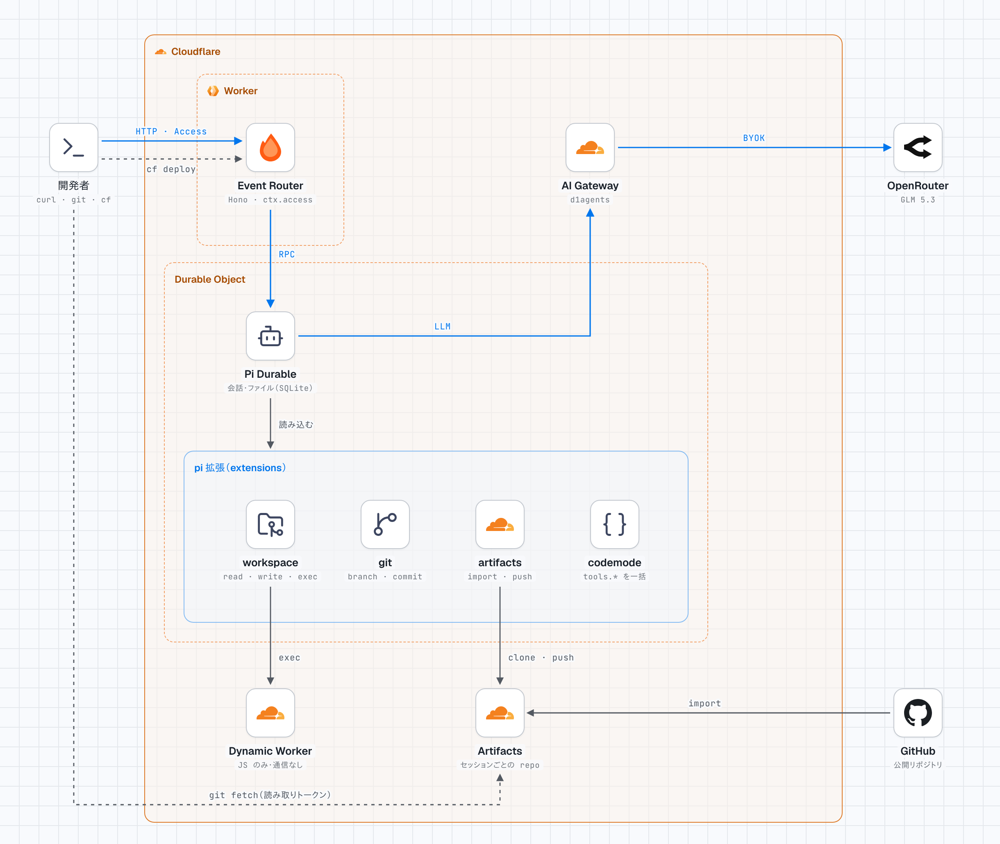
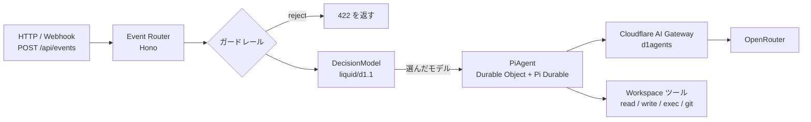

# D1Agents: Pi Durable Agent on Cloudflare

Cloudflare Agents SDK の `PiHarness`（Pi Durable）を Workers + Durable Objects で動かすエージェントです。ブラウザ UI はなく、HTTP API だけで使います。
すべてのリクエストは **Event Router（Hono）** から入ります。**DecisionModel（Liquid d1.1）** が依頼の内容に合う実行モデルを選び、**Pi Durable Agent** がそのモデルで答えます。モデルはすべて OpenRouter のものを Cloudflare AI Gateway 経由で呼びます。

- デプロイ先: https://d1agents-pi-durable.itumens.workers.dev
- 元にしたサンプル: [cloudflare/agents `examples/next/harnesses/pi`](https://github.com/cloudflare/agents/tree/main/examples/next/harnesses/pi)
- ドキュメント: [Pi harness](https://developers.cloudflare.com/agents/harnesses/pi/)

<picture>
  <source media="(prefers-color-scheme: dark)" srcset="docs/architecture/current-dark.png">
  
</picture>

現状と、目指す構成（案）の比較は [`docs/architecture/`](docs/architecture/README.md) にあります。

## 全体の流れ



| 層 | ファイル | 役割 |
| --- | --- | --- |
| Event Router | `src/router.ts` | Hono で HTTP を受け、イベントの形にそろえる |
| DecisionModel | `src/decision-model.ts` | ガードレールのあと、d1.1 に実行モデルを選ばせる |
| 実行モデル一覧 | `src/models.ts` | 候補モデルと、d1.1 に渡す判断基準（`criteria`） |
| PiAgent | `src/server.ts` | Pi Durable を動かす Durable Object。選ばれたモデルに切り替えて回答する |
| Workspace ツール | `src/workspace.ts` | Durable Object の SQLite 上のファイル操作と、JavaScript 実行（`exec`） |

1 つのセッションは 1 つの Durable Object です。会話履歴とワークスペースのファイルはその SQLite に保存されるので、Durable Object がメモリから消えても続きから答えます。

## DecisionModel の判定手順

| 順番 | 段階 | 内容 | `decidedBy` |
| --- | --- | --- | --- |
| 1 | ガードレール（入力チェック） | 空文字、8000 文字超、禁止パターンは `reject`（d1.1 は呼ばない） | `guardrail` |
| 2 | Liquid d1.1 | 依頼文を `state` として渡し、`choice` 型の質問で実行モデルを 1 つ選ばせる | `d1.1` |
| 3 | フォールバック | d1.1 の失敗、確信度 0.4 未満、候補外の答えのときは既定モデル（`z-ai/glm-5.3`） | `fallback` |
| ー | 手動指定 | `/api/events` に `model` を付けると d1.1 を飛ばしてそのモデルを使う | `override` |

d1.1 は会話をしない「判定専用」のモデルです。1 回あたり約 0.0000018〜0.0000038 ドル、0.3〜1 秒で答え、候補ごとの確率も返します。

| 項目 | 内容 |
| --- | --- |
| 呼び先 | OpenRouter の `/api/alpha/decisions`（alpha 版） |
| AI Gateway での指定 | provider `openrouter`、endpoint `../alpha/decisions`（Gateway の OpenRouter は `/api/v1` が起点のため） |
| 入力 | `state`（依頼文など）と `questions`（質問の型は `choice` / `score` / `noul`） |
| 出力 | `choice`（選ばれたモデル）、`probabilities`、`confidence` |

## 実行モデル

d1.1 は下の「判断基準」を読んで選びます。`src/models.ts` の `EXECUTION_MODELS` を書き換えると候補を変えられます。料金は OpenRouter の 100 万トークンあたり（入力 / 出力）です。

| モデル | 判断基準（要約） | 料金 |
| --- | --- | --- |
| `deepseek/deepseek-v4.1-flash` | あいさつ、短い質問、簡単な計算 | $0.04 / $0.50 |
| `z-ai/glm-5.3`（既定） | ファイル操作、コード実行、git、複数手順のツール作業 | $0.07 / $1.40 |
| `google/gemini-3.8-flash` | 要約、説明、中くらいの難しさの混合タスク | $0.83 / $4.12 |
| `qwen/qwen3.8-max-0902` | 設計判断、比較、トレードオフ分析 | $2.00 / $6.00 |
| `tencent/hy4` | 文書作成、情報整理、ビジネス文書 | $0.42 / $1.25 |

実際に試したときの振り分け:

| 依頼 | 選ばれたモデル | 確信度 |
| --- | --- | --- |
| おはよう！ | DeepSeek V4.1 Flash | 0.99 |
| exec でファイルを書いて読み返す | GLM 5.3 | 0.46 |
| RDB とドキュメント DB の設計判断 | Qwen3.8 Max | 0.85 |

### OpenRouter の呼び方

| 項目 | 内容 |
| --- | --- |
| API キー | AI Gateway `d1agents` の Provider Keys に登録（BYOK）。Worker はキーを持たない |
| Gateway の指定 | `cloudflare.config.ts` の `AI_GATEWAY_ID` |
| Pi への登録 | `gatewayOpenRouterProvider()` が `openrouter` という名前の pi-ai プロバイダーを作り、すべてのリクエストを `AI` バインディング経由で Gateway に流す |
| モデル情報 | pi-ai の OpenRouter カタログから取得。カタログにない `tencent/hy4` は `hy4-preview` を元に料金だけ差し替え |

Gemini は再帰する JSON スキーマを受け付けません。そのため `exec` ツールの `input` は「任意のオブジェクト」として渡しています（`src/workspace.ts`）。

## API

| メソッド | パス | 内容 |
| --- | --- | --- |
| GET | `/api/health` | 動作確認と、実行モデル一覧 |
| POST | `/api/decide` | DecisionModel だけを実行（実行モデルは呼ばない） |
| POST | `/api/events` | Router → DecisionModel → Pi → LLM の全体を実行 |
| GET | `/api/sessions/:id/decisions` | そのセッションの判定ログ（新しい順） |
| GET | `/api/sessions/:id/repos` | そのセッションの Artifacts リポジトリと、1 時間有効な読み取り専用トークン（`API_TOKEN` の設定が必要） |

### 認証

Worker の secret `API_TOKEN` を設定すると、`/api/health` 以外のすべての API に `Authorization: Bearer <API_TOKEN>` が必要になります。設定していないあいだは、誰でも呼べます（`/api/health` の `auth` が `none` になります）。

```bash
pnpm exec wrangler secret put API_TOKEN --name d1agents-pi-durable
```

`cf` は beta のため、secret を 1 つだけ登録するコマンドがまだありません。secret の登録だけは Wrangler を使います（設定ファイルを読まないので、`--name` で Worker 名を渡します）。

GitHub に push するツールは、`API_TOKEN` が設定されているときだけ有効になります（後述）。

`/api/events` の入力:

| フィールド | 必須 | 既定値 | 説明 |
| --- | --- | --- | --- |
| `text` | はい | なし | エージェントへの指示 |
| `session` | いいえ | `default` | Durable Object 名。同じ名前なら会話とファイルが続く |
| `id` | いいえ | ランダム | 冪等キー。同じ id は 1 回だけ処理される |
| `source` / `type` | いいえ | `http` / `message` | イベントの出どころ。会話ログに残る |
| `wait` | いいえ | `true` | `false` で受け付けだけ返し、回答はバックグラウンドで進む |
| `model` | いいえ | なし | 実行モデルの ID。指定すると d1.1 を飛ばしてそのモデルで答える |

### 試す

`API_TOKEN` を設定したあとは、手元の環境変数に同じ値を入れてから実行します。

```bash
export D1AGENTS_TOKEN='<API_TOKEN と同じ値>'
```

判定だけを見る:

```bash
curl -s -X POST https://d1agents-pi-durable.itumens.workers.dev/api/decide -H "authorization: Bearer $D1AGENTS_TOKEN" -H 'content-type: application/json' -d '{"text":"マイクロサービスとモノリスを比較して"}'
```

LLM まで通す:

```bash
curl -s -X POST https://d1agents-pi-durable.itumens.workers.dev/api/events -H "authorization: Bearer $D1AGENTS_TOKEN" -H 'content-type: application/json' -d '{"session":"demo","text":"/workspace/haiku.txt に俳句を書いて保存し、読み返して"}'
```

モデルを指定して試す（d1.1 を飛ばす）:

```bash
curl -s -X POST https://d1agents-pi-durable.itumens.workers.dev/api/events -H "authorization: Bearer $D1AGENTS_TOKEN" -H 'content-type: application/json' -d '{"session":"demo","model":"tencent/hy4","text":"勉強会の案内文を書いて"}'
```

判定ログを見る:

```bash
curl -s https://d1agents-pi-durable.itumens.workers.dev/api/sessions/demo/decisions -H "authorization: Bearer $D1AGENTS_TOKEN"
```

どのモデルが実際に答えたかは、Cloudflare ダッシュボードの AI Gateway `d1agents` のログでも確認できます。

## Code Mode

Pi Durable の Code Mode（`src/extensions/codemode.ts`）を入れています。モデルは JavaScript のスクリプトを 1 つ書き、その中で自分のツールを `tools.<名前>(引数)` として呼びます。たくさんのファイルを読む、決まった順でツールを呼ぶ、といった作業を 1 回の呼び出しで済ませられます。

| 項目 | 内容 |
| --- | --- |
| 部品 | `@earendil-works/pi-durable/codemode` の `createCodemodeExtension` と、`@earendil-works/pi-codemode/cloudflare` の `createInlineCodemodeSandbox` |
| 実行場所 | QuickJS（WebAssembly）を、PiAgent の Durable Object の中で動かす |
| 止まっても続く | ツールの結果を 1 つずつ記録しておき、Durable Object が再起動したら、スクリプトを最初から同じ結果で再生して続きから動かす |
| 制限 | 計算だけで進められるのは約 3 秒（割り込み 30,000 回）、メモリ 32 MB、全体で 5 分 |
| `models.*` | 使わない（`models: false`）。スクリプトからモデルを何度も呼ぶと、DecisionModel を通らずに費用がかかるため |
| ツールの決まり | スクリプトから呼んでも同じ。たとえば `tools.git_push` で `main` を push しようとしても断られる |

コードを動かすツールは 2 つあり、役割が違います。

| ツール | 動くもの | 向いている作業 |
| --- | --- | --- |
| `exec` | ワークスペースの中の JavaScript（`node:fs` と git が使える） | ファイルを読んで計算する |
| `codemode` | エージェント自身のツールを呼ぶスクリプト | ツールをまとめて何度も呼ぶ |

スクリプトが計算を続けているあいだは、同じセッションへの他の指示（中止も含む）が待たされます。重い計算が多くなったら、スクリプトを別の Worker で動かす `RemoteCodemodeSandbox` に切り替えます（`createCodemodeSandbox` を差し替えるだけで済む作りです）。

## Artifacts（エージェントの git リポジトリ）

エージェントのリポジトリは Cloudflare Artifacts（Git 互換の保存場所）に置きます。pi 拡張 `artifacts`（`src/extensions/artifacts.ts`）と `git`（`src/extensions/git.ts`）が担当します。

| 項目 | 内容 |
| --- | --- |
| 名前空間 | `d1agents`（`cloudflare.config.ts` の `ARTIFACTS` binding） |
| リポジトリの単位 | セッションごと。Artifacts 上では `<セッション名>__<リポジトリ名>` という名前になります |
| 認証 | binding がリポジトリごと・10 分のトークンをその都度発行し、使い終わったら取り消します。秘密情報の設定は要りません |
| 料金 | Workers Paid プランが必要。毎月 1 万回の操作と 1 GB までは無料（課金は 2026 年 11 月 12 日から） |

| ツール | 内容 |
| --- | --- |
| `repo_import` | 公開されている Git リポジトリ（HTTPS）を取り込み、`/workspace` に clone する |
| `repo_create` | 空のリポジトリを作り、`/workspace` に手元のリポジトリを用意する |
| `repo_clone` | このセッションのリポジトリを `/workspace` に clone する |
| `git_branch` | `agent/` で始まるブランチを作って切り替える |
| `git_commit` | 作業ツリーの変更をすべて commit する |
| `repo_push` | いまのブランチを、同じ名前のブランチに push する（`agent/` だけ） |
| `repo_list` | このセッションのリポジトリの一覧 |

エージェントの成果は、`/api/sessions/:id/repos` で受け取った remote と読み取り専用トークンを使って、手元の `git` で確かめます。

```bash
git -c http.extraHeader="Authorization: Bearer $READ_TOKEN" clone --branch agent/first "$REMOTE" review
```

トークンを remote の URL に入れないので、`.git/config` には残りません。

## GitHub への push と PR 作成（停止中）

いまはエージェントの作業場を Artifacts にしているため、GitHub App の準備は止めています。以下の仕組みはコードに残してありますが、設定しない限り動きません。push のツール名は `github_push` です（`git_branch` と `git_commit` は共通の `git` 拡張にあります）。


pi 拡張 `github`（`src/extensions/github.ts`）が、GitHub App の権限でリポジトリを clone し、ブランチを切って commit・push し、PR を作ります。

| ツール | 内容 |
| --- | --- |
| `github_clone` | 許可したリポジトリを `/workspace` に clone する |
| `git_branch` | `agent/` で始まるブランチを作って切り替える |
| `git_commit` | 作業ツリーの変更をすべて commit する |
| `git_push` | いまのブランチを、同じ名前のブランチに push する |
| `create_pull_request` | draft の PR を作る。同じブランチの PR が開いていれば、それを返す |

ツールの中で守る決まり（モデルの指示に関係なく守られます）:

| 決まり | 内容 |
| --- | --- |
| リポジトリ | `GITHUB_REPOS` に書いたものだけ |
| ブランチ | push できるのは `agent/` で始まるブランチだけ。force push、削除、別名のブランチへの push はできない |
| トークン | 1 時間で切れるトークンを、対象のリポジトリと権限（contents と pull requests の書き込み）に絞って発行する。トークンはリクエストのヘッダーにだけ入れ、ワークスペース（`exec` から読める場所）やモデルへの出力には出さない |

### 設定

| 項目 | 置き場所 | 値 |
| --- | --- | --- |
| `GITHUB_APP_ID` | `cloudflare.config.ts` の `env`（`bindings.text`） | App の設定画面の App ID |
| `GITHUB_APP_INSTALLATION_ID` | `cloudflare.config.ts` の `env`（`bindings.text`） | インストール後の URL の末尾の数字 |
| `GITHUB_REPOS` | `cloudflare.config.ts` の `env`（`bindings.text`） | push を許すリポジトリ（`owner/name` をカンマ区切り） |
| `GITHUB_APP_PRIVATE_KEY` | Worker の secret | App の秘密鍵（ダウンロードした `.pem` をそのまま。PKCS#1 のままで読めます） |
| `API_TOKEN` | Worker の secret | API の認証（上記） |

この 5 つがそろうまで、GitHub のツールはモデルに出ません。

```bash
pnpm exec wrangler secret put GITHUB_APP_PRIVATE_KEY --name d1agents-pi-durable < d1agents-bot.private-key.pem
```

GitHub App の作り方:

| 手順 | 場所・操作 | 設定 |
| --- | --- | --- |
| 1 | Settings → Developer settings → GitHub Apps → New GitHub App | 名前（例：`d1agents-bot`）、Homepage URL（リポジトリの URL） |
| 2 | Webhook | 「Active」のチェックを外す |
| 3 | Repository permissions | Contents：Read and write、Pull requests：Read and write、Metadata：Read-only |
| 4 | Where can this GitHub App be installed? | Only on this account |
| 5 | 作成後の画面 | Generate a private key（`.pem` がダウンロードされる） |
| 6 | Install App | Only select repositories で、使うリポジトリだけを選ぶ |

あわせて、リポジトリの `main` にブランチ保護（またはルールセット）を設定しておくと、ツールの決まりに不具合があっても GitHub 側で `main` への直接の push を止められます。

Pi は会話を作った時点でツールの一覧を決めます。GitHub のツールを有効にする前に作った会話（`session`）では使えないので、新しい `session` 名で試してください。

## ツールチェーン

| 道具 | 用途 | コマンド |
| --- | --- | --- |
| `cf` CLI（beta） | 開発サーバー、ビルド、デプロイ、型の生成、Cloudflare リソースの操作 | `pnpm start` / `pnpm build` / `pnpm run deploy` / `pnpm types` |
| Vite（Vite+ と Cloudflare Vite プラグイン beta） | `cf` が中で使うビルド | `vite.config.ts` |
| Hono | Event Router | `src/router.ts` |
| Wrangler | secret の登録（`cf` が未対応のため）と、テスト用の設定 | `pnpm exec wrangler secret put <名前> --name d1agents-pi-durable` |
| Vitest 5（Vite+ 経由）+ `@cloudflare/vitest-plugin` | Workers 上のテスト | `pnpm test` |

Worker の設定は `cloudflare.config.ts`（TypeScript）に書きます。`wrangler.jsonc` から `cf migrate` で移行しました。バインディングと実行環境の型は `cf` が `.cloudflare/types/` に生成します（`pnpm typecheck` が先に生成します）。

| 項目 | 置き場所 |
| --- | --- |
| Worker 名、互換日、バインディング、Durable Object | `cloudflare.config.ts` |
| ビルドの設定（プラグイン、依存の重複排除） | `vite.config.ts` |
| 生成物（ビルド結果、型） | `.cloudflare/`（git には入れない） |
| テスト用の Worker の設定 | `src/tests/wrangler.jsonc`（`@cloudflare/vitest-plugin` が読む） |

`cf` に関係なく調べものをするときは `pnpm exec cf cli search "<やりたいこと>"` が使えます。

テストは Workers ランタイムで動きます（設定は `src/tests/vitest.config.ts`）。`src/tests/worker.ts` は本番と同じ Pi Durable + Workspace の組み合わせを、pi-ai の faux モデルで動かすテスト用の Durable Object です。

| テスト | 確かめること |
| --- | --- |
| `decision-model.test.ts` | ガードレールとフォールバックの判定 |
| `workspace.test.ts` | Workspace ツールの結果がモデルに渡ること |
| `durable.test.ts` | Durable Object を退避（evict）しても、ワークスペースとセッションが続くこと |
| `auth.test.ts` | `API_TOKEN` を設定すると、トークンのない呼び出しを 401 で断ること |
| `github-app.test.ts` | GitHub App の鍵（PKCS#1 / PKCS#8）の読み込み、JWT の署名、トークンの絞り込みとキャッシュ |
| `artifacts.test.ts` | リポジトリの作成・取り込み（読めるようになるまで待つ）・一覧、`agent/` 以外の push とおかしな名前やパスを断ること、トークンを毎回取り消して出力に出さないこと（Artifacts は偽物で代用。実際の clone と push は `cf dev` で確かめた） |
| `codemode.test.ts` | Code Mode のスクリプトから複数のツールを呼べること、GitHub の決まりがスクリプトからの呼び出しにも効くこと、計算し続けるスクリプトが止まること |
| `github-extension.test.ts` | branch・commit の動き、`agent/` 以外と許可外のリポジトリを断ること、PR 作成の重複防止、トークンが出力に出ないこと（GitHub は偽物の API で代用。実際の push はテストしていない） |

## ローカルで動かす

```bash
pnpm install
```

```bash
pnpm start
```

起動したら `http://localhost:5173/api/health` などに `curl` で送れます。`AI` バインディングはリモートで動かすため、`cf auth login` でログインしておく必要があります（`cf` は Wrangler のログインを使いません）。OpenRouter のキーは AI Gateway が持つので、手元に置く必要はありません。

## デプロイ

```bash
pnpm run deploy
```

`cf deploy` がビルドしてからデプロイします。Worker と Durable Object だけで、静的ファイル（Static Assets）はありません。アップロードせずに中身だけ確かめるときは、次のコマンドを使います。

```bash
pnpm exec cf deploy --dry-run
```

ログを流して見る機能（`wrangler tail`）は `cf` にまだないので、`pnpm exec wrangler tail d1agents-pi-durable` を使います。

## 元のサンプルからの変更点

| 項目 | 元のサンプル | このリポジトリ |
| --- | --- | --- |
| 入口 | `fetch` 関数で直接振り分け | Hono の Event Router |
| 画面 | React のチャット UI（WebSocket） | なし。HTTP API のみ |
| モデル選択 | 固定（Workers AI `glm-5.3-flash`） | d1.1 が毎回 OpenRouter の 5 モデルから選ぶ |
| HTTP からの利用 | なし | `POST /api/events` |
| 判定ログ | なし | Durable Object の SQLite に `router_decisions` テーブル |
| ビルドとデプロイ | Vite と Wrangler | `cf` CLI（`cloudflare.config.ts`、中は Vite+） |
| `agents` バージョン | `*`（monorepo 内） | `^0.33.0`（Pi 1.5 対応） |
| `@cloudflare/computer` | 0.8（`WorkerJavaScriptBackend`、`ws:git`） | 0.10（`CodemodeBackend`、`codemode:git`） |

Pi harness 本体の設計メモは [`docs/upstream-README.md`](docs/upstream-README.md) と [`docs/upstream-NOTES.md`](docs/upstream-NOTES.md) にあります。Pi は MIT ライセンスです（[`licenses/mit-earendil-pi.txt`](licenses/mit-earendil-pi.txt)）。
