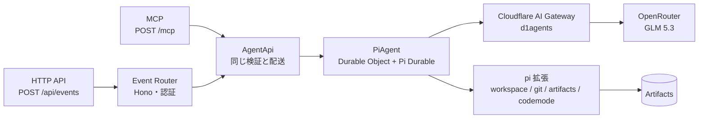

# D1Agents: Pi Durable Agent on Cloudflare

Cloudflare Agents SDK の `PiHarness`（Pi Durable）を Workers + Durable Objects で動かすエージェントです。ブラウザ UI はなく、HTTP API とリモート MCP（Streamable HTTP の `/mcp`）で使います。
HTTP は **Event Router（Hono）** から入り、MCP のツールは同じ受付（`AgentApi`）を通ります。どちらも **Pi Durable Agent** が答えます。モデルは OpenRouter の GLM 5.3 に固定し、Cloudflare AI Gateway 経由で呼びます。

- デプロイ先: https://d1agents-pi-durable.itumens.workers.dev
- 元にしたサンプル: [cloudflare/agents `examples/next/harnesses/pi`](https://github.com/cloudflare/agents/tree/main/examples/next/harnesses/pi)
- ドキュメント: [Pi harness](https://developers.cloudflare.com/agents/harnesses/pi/)

<picture>
  <source media="(prefers-color-scheme: dark)" srcset="docs/architecture/current-dark.png">
  
</picture>

現状と、目指す構成（案）の比較は [`docs/architecture/`](docs/architecture/README.md) にあります。

## 全体の流れ



| 層 | ファイル | 役割 |
| --- | --- | --- |
| Worker の入口 | `src/index.ts` | `/mcp` を MCP に、それ以外を Event Router に渡し、PiAgent を公開する |
| Event Router | `src/router.ts` | Hono で HTTP を受け、認証し、`AgentApi` に渡す |
| 受付 | `src/agent-api.ts` | 認証、依頼の検証（空の依頼と 8,000 文字を超える依頼は断る）、PiAgent への配送。HTTP と MCP が共用する |
| MCP | `src/mcp.ts` | Streamable HTTP の `/mcp`。ツールは `AgentApi` を呼ぶ |
| イベント | `src/event.ts` | そろえたイベントの型 |
| 会話への記録 | `src/event-session.ts` | 依頼を Pi の会話ログに載せる（`source` は出どころ） |
| モデル | `src/model.ts` | GLM 5.3 の情報と、AI Gateway 経由で OpenRouter を呼ぶプロバイダー |
| PiAgent | `src/agent.ts` | Pi Durable を動かす Durable Object |
| pi 拡張 | `src/extensions/` | モデルに見えるもの（システムプロンプトとツール）。下の表 |

| pi 拡張 | ファイル | 中身 |
| --- | --- | --- |
| `workspace` | `src/extensions/workspace.ts` | システムプロンプトと、Durable Object の SQLite 上のファイル操作・JavaScript 実行（`exec`） |
| `git` | `src/extensions/git.ts` | `git_branch` と `git_commit`、push の決まり（`agent/` ブランチだけ など） |
| `artifacts` | `src/extensions/artifacts.ts` | Cloudflare Artifacts のリポジトリ（取り込み・作成・clone・push・一覧） |
| `codemode` | `src/extensions/codemode.ts` | スクリプトからツールをまとめて呼ぶ Code Mode |

1 つのセッションは 1 つの Durable Object です。会話履歴とワークスペースのファイルはその SQLite に保存されるので、Durable Object がメモリから消えても続きから答えます。

## モデル

GLM 5.3（`z-ai/glm-5.3`、OpenRouter の 100 万トークンあたり入力 $0.07 / 出力 $1.40）に固定しています。変えるときは `src/model.ts` の `MODEL_ID` を書き換えます。

### OpenRouter の呼び方

| 項目 | 内容 |
| --- | --- |
| API キー | AI Gateway `d1agents` の Provider Keys に登録（BYOK）。Worker はキーを持たない |
| Gateway の指定 | `cloudflare.config.ts` の `AI_GATEWAY_ID` |
| Pi への登録 | `gatewayOpenRouterProvider()` が `openrouter` という名前の pi-ai プロバイダーを作り、すべてのリクエストを `AI` バインディング経由で Gateway に流す |
| モデル情報 | pi-ai の OpenRouter カタログから取得 |

Gemini は再帰する JSON スキーマを受け付けません。そのため `exec` ツールの `input` は「任意のオブジェクト」として渡しています（`src/extensions/workspace.ts`）。

## API

| メソッド | パス | 内容 |
| --- | --- | --- |
| GET | `/api/health` | 動作確認と、使っているモデル |
| POST | `/api/events` | エージェントに依頼する |
| GET | `/api/sessions/:id/repos` | そのセッションの Artifacts リポジトリと、1 時間有効な読み取り専用トークン（`API_TOKEN` の設定が必要） |

### 認証

Worker の secret `API_TOKEN` を設定すると、`/api/health` 以外のすべての API と、MCP の `/mcp` に `Authorization: Bearer <API_TOKEN>` が必要になります。設定していないあいだは、誰でも呼べます（`/api/health` の `auth` が `none` になります）。`/api/health` はトークンを設定したあとも開いたままです。MCP はエンドポイント全体がトークンを要求します。ブラウザの事前リクエスト（OPTIONS）だけは、Authorization を付けられないので通ります。

```bash
pnpm exec wrangler secret put API_TOKEN --name d1agents-pi-durable
```

`cf` は beta のため、secret を 1 つだけ登録するコマンドがまだありません。secret の登録だけは Wrangler を使います（設定ファイルを読まないので、`--name` で Worker 名を渡します）。名前は `cloudflare.config.ts` の `API_TOKEN`（`bindings.secret()`）です。手元では `.dev.vars` に `API_TOKEN=<値>` と書くと、`pnpm start` が同じトークンを要求します。

`/api/sessions/:id/repos`（読み取りトークンを渡す入口）は、`API_TOKEN` が設定されているときだけ使えます。

`/api/events` の入力:

| フィールド | 必須 | 既定値 | 説明 |
| --- | --- | --- | --- |
| `text` | はい | なし | エージェントへの指示 |
| `session` | いいえ | `default` | Durable Object 名。同じ名前なら会話とファイルが続く |
| `id` | いいえ | ランダム | 冪等キー。同じ id は 1 回だけ処理される |
| `source` / `type` | いいえ | `http` / `message` | イベントの出どころ。会話ログに残る |
| `wait` | いいえ | `true` | `false` で受け付けだけ返し、回答はバックグラウンドで進む |

### 試す

`API_TOKEN` を設定したあとは、手元の環境変数に同じ値を入れてから実行します。

```bash
export D1AGENTS_TOKEN='<API_TOKEN と同じ値>'
```

依頼する:

```bash
curl -s -X POST https://d1agents-pi-durable.itumens.workers.dev/api/events -H "authorization: Bearer $D1AGENTS_TOKEN" -H 'content-type: application/json' -d '{"session":"demo","text":"/workspace/haiku.txt に俳句を書いて保存し、読み返して"}'
```

エージェントの成果（Artifacts のリポジトリ）を受け取る:

```bash
curl -s https://d1agents-pi-durable.itumens.workers.dev/api/sessions/demo/repos -H "authorization: Bearer $D1AGENTS_TOKEN"
```

モデルへのリクエストは、Cloudflare ダッシュボードの AI Gateway `d1agents` のログで確認できます。

## MCP

Grok Bots などのリモート MCP コネクタから、同じ Worker を呼べます。エンドポイントは Streamable HTTP の `/mcp` です（`agents/mcp/server` の `createMcpHandler`）。OAuth はまだありません。クライアントが静的な `Authorization` ヘッダーを付けます。

| ツール | 対応する API | 内容 |
| --- | --- | --- |
| `send_event` | `POST /api/events` | エージェントに依頼する。`text`、`session`（既定 `default`）、冪等キー `id`、`wait`（既定 `true`）。空の依頼と 8,000 文字を超える依頼は HTTP と同じ文言で断る。会話ログの `source` は `mcp`、`type` は `message` |
| `session_repos` | `GET /api/sessions/:id/repos` | そのセッションの Artifacts リポジトリと、1 時間有効な読み取り専用トークン。`API_TOKEN` が未設定のときは断る |
| `health` | `GET /api/health` | 動作確認、認証の有無、使っているモデル |

ツールの戻り値は、対応する HTTP API と同じ JSON です。検証で断ったときは `{ "error": "..." }` をツールエラーとして返します。

コネクタには次を登録します。

| 項目 | 値 |
| --- | --- |
| URL | `https://d1agents-pi-durable.itumens.workers.dev/mcp` |
| トランスポート | Streamable HTTP |
| ヘッダー | `Authorization: Bearer <API_TOKEN>` |

手元では `pnpm start` のあと、`http://localhost:5173/mcp` に同じヘッダーでつなぎます。

```bash
npx @modelcontextprotocol/inspector --cli http://localhost:5173/mcp --method tools/list --header "Authorization: Bearer $D1AGENTS_TOKEN"
```

```bash
npx @modelcontextprotocol/inspector --cli http://localhost:5173/mcp --method tools/call --tool-name send_event --tool-arg session=demo --tool-arg text="一言で挨拶して" --header "Authorization: Bearer $D1AGENTS_TOKEN"
```

## Code Mode

Pi Durable の Code Mode（`src/extensions/codemode.ts`）を入れています。モデルは JavaScript のスクリプトを 1 つ書き、その中で自分のツールを `tools.<名前>(引数)` として呼びます。たくさんのファイルを読む、決まった順でツールを呼ぶ、といった作業を 1 回の呼び出しで済ませられます。

| 項目 | 内容 |
| --- | --- |
| 部品 | `@earendil-works/pi-durable/codemode` の `createCodemodeExtension` と、`@earendil-works/pi-codemode/cloudflare` の `createInlineCodemodeSandbox` |
| 実行場所 | QuickJS（WebAssembly）を、PiAgent の Durable Object の中で動かす |
| 止まっても続く | ツールの結果を 1 つずつ記録しておき、Durable Object が再起動したら、スクリプトを最初から同じ結果で再生して続きから動かす |
| 制限 | 計算だけで進められるのは約 3 秒（割り込み 30,000 回）、メモリ 32 MB、全体で 5 分 |
| `models.*` | 使わない（`models: false`）。スクリプトからモデルを何度も呼ぶと、費用が見えにくくなるため |
| ツールの決まり | スクリプトから呼んでも同じ。たとえば `tools.repo_push` で `main` を push しようとしても断られる |

コードを動かすツールは 2 つあり、役割が違います。

| ツール | 動くもの | 向いている作業 |
| --- | --- | --- |
| `exec` | ワークスペースの中の JavaScript（`node:fs` と git が使える） | ファイルを読んで計算する |
| `codemode` | エージェント自身のツールを呼ぶスクリプト | ツールをまとめて何度も呼ぶ |

スクリプトが計算を続けているあいだは、同じセッションへの他の指示（中止も含む）が待たされます。重い計算が多くなったら、スクリプトを別の Worker で動かす `RemoteCodemodeSandbox` に切り替えます（`src/extensions/codemode.ts` のサンドボックスを差し替えるだけで済む作りです）。

## Artifacts（エージェントの git リポジトリ）

エージェントのリポジトリは Cloudflare Artifacts（Git 互換の保存場所）に置きます。pi 拡張 `artifacts`（`src/extensions/artifacts.ts`）と `git`（`src/extensions/git.ts`）が担当します。

| 項目 | 内容 |
| --- | --- |
| 名前空間 | `d1agents`（`cloudflare.config.ts` の `ARTIFACTS` binding） |
| リポジトリの単位 | セッションごと。Artifacts 上では `<セッション名>__<リポジトリ名>` という名前になります |
| 認証 | binding がリポジトリごと・10 分のトークンをその都度発行し、使い終わったら取り消します。秘密情報の設定は要りません |
| 料金 | Workers Paid プランが必要。毎月 1 万回の操作と 1 GB までは無料（課金は 2026 年 11 月 12 日から） |

| ツール | 内容 |
| --- | --- |
| `repo_import` | 公開されている Git リポジトリ（HTTPS）を取り込み、`/workspace` に clone する |
| `repo_create` | 空のリポジトリを作り、`/workspace` に手元のリポジトリを用意する |
| `repo_clone` | このセッションのリポジトリを `/workspace` に clone する |
| `git_branch` | `agent/` で始まるブランチを作って切り替える |
| `git_commit` | 作業ツリーの変更をすべて commit する |
| `repo_push` | いまのブランチを、同じ名前のブランチに push する（`agent/` だけ） |
| `repo_list` | このセッションのリポジトリの一覧 |

エージェントの成果は、`/api/sessions/:id/repos` で受け取った remote と読み取り専用トークンを使って、手元の `git` で確かめます。

```bash
git -c http.extraHeader="Authorization: Bearer $READ_TOKEN" clone --branch agent/first "$REMOTE" review
```

トークンを remote の URL に入れないので、`.git/config` には残りません。

## GitHub について

GitHub App で push と PR を作る仕組みは、Artifacts に切り替えたため削除しました。必要になったら、コミット `2fce24f` の `src/extensions/github.ts` と `src/github/app.ts` から戻せます。

## ツールチェーン

| 道具 | 用途 | コマンド |
| --- | --- | --- |
| `cf` CLI（beta） | 開発サーバー、ビルド、デプロイ、型の生成、Cloudflare リソースの操作 | `pnpm start` / `pnpm build` / `pnpm run deploy` / `pnpm types` |
| Vite（Vite+ と Cloudflare Vite プラグイン beta） | `cf` が中で使うビルド | `vite.config.ts` |
| Hono | Event Router | `src/router.ts` |
| Wrangler | secret の登録（`cf` が未対応のため）と、テスト用の設定 | `pnpm exec wrangler secret put <名前> --name d1agents-pi-durable` |
| Vitest 5（Vite+ 経由）+ `@cloudflare/vitest-plugin` | Workers 上のテスト | `pnpm test` |

Worker の設定は `cloudflare.config.ts`（TypeScript）に書きます。`wrangler.jsonc` から `cf migrate` で移行しました。バインディングと実行環境の型は `cf` が `.cloudflare/types/` に生成します（`pnpm typecheck` が先に生成します）。

| 項目 | 置き場所 |
| --- | --- |
| Worker 名、互換日、バインディング、Durable Object | `cloudflare.config.ts` |
| ビルドの設定（プラグイン、依存の重複排除） | `vite.config.ts` |
| 生成物（ビルド結果、型） | `.cloudflare/`（git には入れない） |
| テスト用の Worker の設定 | `src/tests/wrangler.jsonc`（`@cloudflare/vitest-plugin` が読む） |

`cf` に関係なく調べものをするときは `pnpm exec cf cli search "<やりたいこと>"` が使えます。

テストは Workers ランタイムで動きます（設定は `src/tests/vitest.config.ts`）。`src/tests/worker.ts` は本番と同じ Pi Durable + Workspace の組み合わせを、pi-ai の faux モデルで動かすテスト用の Durable Object です。

| テスト | 確かめること |
| --- | --- |
| `durable.test.ts` | Durable Object を退避（evict）しても、ワークスペースとセッションが続くこと。Workspace ツールの結果がモデルに渡ること |
| `auth.test.ts` | `API_TOKEN` を設定すると、トークンのない呼び出しを 401 で断ること |
| `mcp.test.ts` | MCP の initialize と tools/list、ツール呼び出しがエージェントまで届くこと（会話ログの `source` は `mcp`）、`API_TOKEN` があるときの 401 |
| `git.test.ts` | パスを `/workspace` の中に限ること、`agent/` のブランチを作り commit できること、`agent/` 以外のブランチを断ること |
| `artifacts.test.ts` | リポジトリの作成・取り込み（読めるようになるまで待つ）・一覧、`agent/` 以外の push とおかしな名前やパスを断ること、トークンを毎回取り消して出力に出さないこと（Artifacts は偽物で代用。実際の clone と push は `cf dev` で確かめた） |
| `codemode.test.ts` | Code Mode のスクリプトから複数のツールを呼べること、push の決まりがスクリプトからの呼び出しにも効くこと、計算し続けるスクリプトが止まること |

## ローカルで動かす

```bash
pnpm install
```

```bash
pnpm start
```

起動したら `http://localhost:5173/api/health` などに `curl` で送れます。`AI` バインディングはリモートで動かすため、`cf auth login` でログインしておく必要があります（`cf` は Wrangler のログインを使いません）。OpenRouter のキーは AI Gateway が持つので、手元に置く必要はありません。

## デプロイ

```bash
pnpm run deploy
```

`cf deploy` がビルドしてからデプロイします。Worker と Durable Object だけで、静的ファイル（Static Assets）はありません。アップロードせずに中身だけ確かめるときは、次のコマンドを使います。

```bash
pnpm exec cf deploy --dry-run
```

ログを流して見る機能（`wrangler tail`）は `cf` にまだないので、`pnpm exec wrangler tail d1agents-pi-durable` を使います。

## 元のサンプルからの変更点

| 項目 | 元のサンプル | このリポジトリ |
| --- | --- | --- |
| 入口 | `fetch` 関数で直接振り分け | Hono の Event Router |
| 画面 | React のチャット UI（WebSocket） | なし。HTTP API のみ |
| モデル | 固定（Workers AI `glm-5.3-flash`） | 固定（OpenRouter の GLM 5.3、AI Gateway 経由） |
| HTTP からの利用 | なし | `POST /api/events` と、Streamable HTTP の MCP `/mcp` |
| ビルドとデプロイ | Vite と Wrangler | `cf` CLI（`cloudflare.config.ts`、中は Vite+） |
| `agents` バージョン | `*`（monorepo 内） | `^0.33.0`（Pi 1.5 対応） |
| `@cloudflare/computer` | 0.8（`WorkerJavaScriptBackend`、`ws:git`） | 0.10（`CodemodeBackend`、`codemode:git`） |

Pi harness 本体の設計メモは [`docs/upstream-README.md`](docs/upstream-README.md) と [`docs/upstream-NOTES.md`](docs/upstream-NOTES.md) にあります。Pi は MIT ライセンスです（[`licenses/mit-earendil-pi.txt`](licenses/mit-earendil-pi.txt)）。
