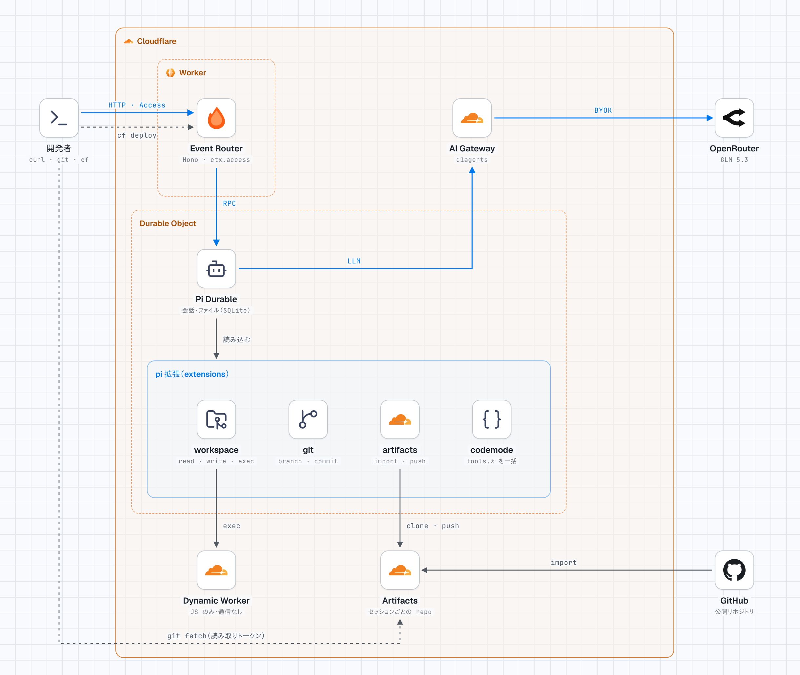
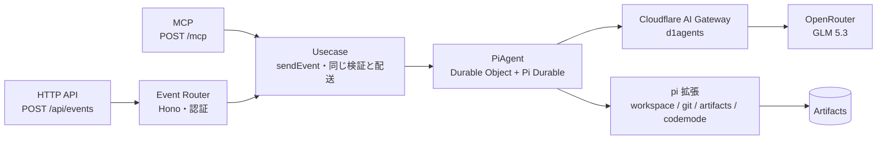

# D1Agents: Pi Durable Agent on Cloudflare

Cloudflare Agents SDK の `PiHarness`（Pi Durable）を Workers + Durable Objects で動かすエージェントです。ブラウザ UI はなく、HTTP API とリモート MCP（Streamable HTTP の `/mcp`）で使います。
HTTP は **Event Router（Hono）** から入り、MCP のツールも同じユースケース（`src/usecase/`）を通ります。どちらも **Pi Durable Agent** が答えます。モデルは OpenRouter の GLM 5.3 に固定し、Cloudflare AI Gateway 経由で呼びます。

- デプロイ先: https://d1agents-pi-durable.itumens.workers.dev
- 元にしたサンプル: [cloudflare/agents `examples/next/harnesses/pi`](https://github.com/cloudflare/agents/tree/main/examples/next/harnesses/pi)
- ドキュメント: [Pi harness](https://developers.cloudflare.com/agents/harnesses/pi/)

<picture>
  <source media="(prefers-color-scheme: dark)" srcset="docs/architecture/current-dark.png">
  
</picture>

現状と、目指す構成（案）の比較は [`docs/architecture/`](docs/architecture/README.md) にあります。

## 全体の流れ



依存は外側から内側への一方向だけです(Application → Infra → Usecase → Domain)。

| 層          | ファイル           | 役割                                                                                                                                                                         |
| ----------- | ------------------ | ---------------------------------------------------------------------------------------------------------------------------------------------------------------------------- |
| Domain      | `src/domain/`      | イベントの形と入力チェック、セッション名、`/workspace` と `agent/` ブランチ、リポジトリ名のルール。外部ライブラリを使わない                                                  |
| Usecase     | `src/usecase/`     | `sendEvent`・`listSessionRepos`・`health`。外の世界は `ports/`(`AgentGateway`・`Authenticator`・`Clock`・`Ids`)越しに触る                                                    |
| Infra       | `src/infra/`       | ポートの実装(Account API トークンの確認、Durable Object の呼び出し、時刻と ID)、OpenRouter の設定、pi 拡張、会話への記録                                                     |
| Application | `src/application/` | Worker の入口(`worker.ts`)、Hono の Event Router(`http/router.ts`)、MCP(`mcp/server.ts`)、Bearer 認証、部品の組み立て(`compose.ts`)、Durable Object `PiAgent`(`pi-agent.ts`) |

| pi 拡張     | ファイル                               | 中身                                                                                       |
| ----------- | -------------------------------------- | ------------------------------------------------------------------------------------------ |
| `workspace` | `src/infra/pi/extensions/workspace.ts` | システムプロンプトと、Durable Object の SQLite 上のファイル操作・JavaScript 実行（`exec`） |
| `git`       | `src/infra/pi/extensions/git.ts`       | `git_branch` と `git_commit`、push の決まり（`agent/` ブランチだけ など）                  |
| `artifacts` | `src/infra/pi/extensions/artifacts.ts` | Cloudflare Artifacts のリポジトリ（取り込み・作成・clone・push・一覧）                     |
| `codemode`  | `src/infra/pi/extensions/codemode.ts`  | スクリプトからツールをまとめて呼ぶ Code Mode                                               |

1 つのセッションは 1 つの Durable Object です。会話履歴とワークスペースのファイルはその SQLite に保存されるので、Durable Object がメモリから消えても続きから答えます。

## モデル

GLM 5.3（`z-ai/glm-5.3`、OpenRouter の 100 万トークンあたり入力 $0.07 / 出力 $1.40）に固定しています。変えるときは `src/infra/llm/openrouter.ts` の `MODEL_ID` を書き換えます。

### OpenRouter の呼び方

| 項目           | 内容                                                                                                                                               |
| -------------- | -------------------------------------------------------------------------------------------------------------------------------------------------- |
| API キー       | AI Gateway `d1agents` の Provider Keys に登録（BYOK）。Worker はキーを持たない                                                                     |
| Gateway の指定 | `cloudflare.config.ts` の `AI_GATEWAY_ID`                                                                                                          |
| Pi への登録    | `gatewayOpenRouterProvider()` が `openrouter` という名前の pi-ai プロバイダーを作り、すべてのリクエストを `AI` バインディング経由で Gateway に流す |
| モデル情報     | pi-ai の OpenRouter カタログから取得                                                                                                               |

Gemini は再帰する JSON スキーマを受け付けません。そのため `exec` ツールの `input` は「任意のオブジェクト」として渡しています（`src/infra/pi/extensions/workspace.ts`）。

## API

| メソッド | パス                      | 内容                                                                      |
| -------- | ------------------------- | ------------------------------------------------------------------------- |
| GET      | `/api/health`             | 動作確認と、使っているモデル                                              |
| POST     | `/api/events`             | エージェントに依頼する                                                    |
| GET      | `/api/sessions/:id/repos` | そのセッションの Artifacts リポジトリと、1 時間有効な読み取り専用トークン |

### 認証

`/api/*` と MCP の `/mcp` は、この Cloudflare アカウントの **アカウント API トークン**（Account API Token）を持つ人とエージェントだけが使えます。

| 項目             | 内容                                                                                                  |
| ---------------- | ----------------------------------------------------------------------------------------------------- |
| 送り方           | `Authorization: Bearer <トークン>` ヘッダー                                                           |
| 確かめ方         | Worker が Cloudflare API の `/accounts/<アカウント ID>/tokens/verify` に問い合わせ、`active` なら通す |
| 通らないとき     | 401 を返す                                                                                            |
| トークンの作り方 | ダッシュボードの **Manage Account → Account API Tokens** で作る。権限は最小のもので足りる             |
| 止め方           | そのトークンを削除するか無効にする                                                                    |
| 例外             | MCP へのブラウザの事前リクエスト（OPTIONS）だけは Authorization を付けられないので通す                |

`/api/events` の入力:

| フィールド        | 必須   | 既定値             | 説明                                                     |
| ----------------- | ------ | ------------------ | -------------------------------------------------------- |
| `text`            | はい   | なし               | エージェントへの指示                                     |
| `session`         | いいえ | `default`          | Durable Object 名。同じ名前なら会話とファイルが続く      |
| `id`              | いいえ | ランダム           | 冪等キー。同じ id は 1 回だけ処理される                  |
| `source` / `type` | いいえ | `http` / `message` | イベントの出どころ。会話ログに残る                       |
| `wait`            | いいえ | `true`             | `false` で受け付けだけ返し、回答はバックグラウンドで進む |

### 試す

アカウント API トークンを `CLOUDFLARE_ACCOUNT_TOKEN` に入れておきます。

```bash
export CLOUDFLARE_ACCOUNT_TOKEN=<アカウント API トークン>
```

依頼する:

```bash
curl https://d1agents-pi-durable.itumens.workers.dev/api/events -X POST -H "authorization: Bearer $CLOUDFLARE_ACCOUNT_TOKEN" -H 'content-type: application/json' -d '{"session":"demo","text":"/workspace/haiku.txt に俳句を書いて保存し、読み返して"}'
```

エージェントの成果（Artifacts のリポジトリ）を受け取る:

```bash
curl https://d1agents-pi-durable.itumens.workers.dev/api/sessions/demo/repos -H "authorization: Bearer $CLOUDFLARE_ACCOUNT_TOKEN"
```

モデルへのリクエストは、Cloudflare ダッシュボードの AI Gateway `d1agents` のログで確認できます。

## MCP

Grok Bots などのリモート MCP コネクタから、同じ Worker を呼べます。エンドポイントは Streamable HTTP の `/mcp` です（`agents/mcp/server` の `createMcpHandler`）。OAuth はまだありません。クライアントが静的な `Authorization` ヘッダーを付けます。

| ツール          | 対応する API                  | 内容                                                                                                                                                                                                            |
| --------------- | ----------------------------- | --------------------------------------------------------------------------------------------------------------------------------------------------------------------------------------------------------------- |
| `send_event`    | `POST /api/events`            | エージェントに依頼する。`text`、`session`（既定 `default`）、冪等キー `id`、`wait`（既定 `true`）。空の依頼と 8,000 文字を超える依頼は HTTP と同じ文言で断る。会話ログの `source` は `mcp`、`type` は `message` |
| `session_repos` | `GET /api/sessions/:id/repos` | そのセッションの Artifacts リポジトリと、1 時間有効な読み取り専用トークン                                                                                                                                       |
| `health`        | `GET /api/health`             | 動作確認と、使っているモデル                                                                                                                                                                                    |

ツールの戻り値は、対応する HTTP API と同じ JSON です。検証で断ったときは `{ "error": "..." }` をツールエラーとして返します。

コネクタには次を登録します。

| 項目           | 値                                                    |
| -------------- | ----------------------------------------------------- |
| URL            | `https://d1agents-pi-durable.itumens.workers.dev/mcp` |
| トランスポート | Streamable HTTP                                       |
| ヘッダー       | `Authorization: Bearer <アカウント API トークン>`     |

手元では `bun run start` のあと、`http://localhost:5173/mcp` に同じヘッダーでつなぎます。

```bash
npx @modelcontextprotocol/inspector --cli http://localhost:5173/mcp --method tools/list --header "Authorization: Bearer $CLOUDFLARE_ACCOUNT_TOKEN"
```

```bash
npx @modelcontextprotocol/inspector --cli http://localhost:5173/mcp --method tools/call --tool-name send_event --tool-arg session=demo --tool-arg text="一言で挨拶して" --header "Authorization: Bearer $CLOUDFLARE_ACCOUNT_TOKEN"
```

## Code Mode

Pi Durable の Code Mode（`src/infra/pi/extensions/codemode.ts`）を入れています。モデルは JavaScript のスクリプトを 1 つ書き、その中で自分のツールを `tools.<名前>(引数)` として呼びます。たくさんのファイルを読む、決まった順でツールを呼ぶ、といった作業を 1 回の呼び出しで済ませられます。

| 項目           | 内容                                                                                                                                             |
| -------------- | ------------------------------------------------------------------------------------------------------------------------------------------------ |
| 部品           | `@earendil-works/pi-durable/codemode` の `createCodemodeExtension` と、`@earendil-works/pi-codemode/cloudflare` の `createInlineCodemodeSandbox` |
| 実行場所       | QuickJS（WebAssembly）を、PiAgent の Durable Object の中で動かす                                                                                 |
| 止まっても続く | ツールの結果を 1 つずつ記録しておき、Durable Object が再起動したら、スクリプトを最初から同じ結果で再生して続きから動かす                         |
| 制限           | 計算だけで進められるのは約 3 秒（割り込み 30,000 回）、メモリ 32 MB、全体で 5 分                                                                 |
| `models.*`     | 使わない（`models: false`）。スクリプトからモデルを何度も呼ぶと、費用が見えにくくなるため                                                        |
| ツールの決まり | スクリプトから呼んでも同じ。たとえば `tools.repo_push` で `main` を push しようとしても断られる                                                  |

コードを動かすツールは 2 つあり、役割が違います。

| ツール     | 動くもの                                                     | 向いている作業             |
| ---------- | ------------------------------------------------------------ | -------------------------- |
| `exec`     | ワークスペースの中の JavaScript（`node:fs` と git が使える） | ファイルを読んで計算する   |
| `codemode` | エージェント自身のツールを呼ぶスクリプト                     | ツールをまとめて何度も呼ぶ |

スクリプトが計算を続けているあいだは、同じセッションへの他の指示（中止も含む）が待たされます。重い計算が多くなったら、スクリプトを別の Worker で動かす `RemoteCodemodeSandbox` に切り替えます（`src/infra/pi/extensions/codemode.ts` のサンドボックスを差し替えるだけで済む作りです）。

## Artifacts（エージェントの git リポジトリ）

エージェントのリポジトリは Cloudflare Artifacts（Git 互換の保存場所）に置きます。pi 拡張 `artifacts`（`src/infra/pi/extensions/artifacts.ts`）と `git`（`src/infra/pi/extensions/git.ts`）が担当します。

| 項目             | 内容                                                                                                              |
| ---------------- | ----------------------------------------------------------------------------------------------------------------- |
| 名前空間         | `d1agents`（`cloudflare.config.ts` の `ARTIFACTS` binding）                                                       |
| リポジトリの単位 | セッションごと。Artifacts 上では `<セッション名>__<リポジトリ名>` という名前になります                            |
| 認証             | binding がリポジトリごと・10 分のトークンをその都度発行し、使い終わったら取り消します。秘密情報の設定は要りません |
| 料金             | Workers Paid プランが必要。毎月 1 万回の操作と 1 GB までは無料（課金は 2026 年 11 月 12 日から）                  |

| ツール        | 内容                                                                         |
| ------------- | ---------------------------------------------------------------------------- |
| `repo_import` | 公開されている Git リポジトリ（HTTPS）を取り込み、`/workspace` に clone する |
| `repo_create` | 空のリポジトリを作り、`/workspace` に手元のリポジトリを用意する              |
| `repo_clone`  | このセッションのリポジトリを `/workspace` に clone する                      |
| `git_branch`  | `agent/` で始まるブランチを作って切り替える                                  |
| `git_commit`  | 作業ツリーの変更をすべて commit する                                         |
| `repo_push`   | いまのブランチを、同じ名前のブランチに push する（`agent/` だけ）            |
| `repo_list`   | このセッションのリポジトリの一覧                                             |

エージェントの成果は、`/api/sessions/:id/repos` で受け取った remote と読み取り専用トークンを使って、手元の `git` で確かめます。

```bash
git -c http.extraHeader="Authorization: Bearer $READ_TOKEN" clone --branch agent/first "$REMOTE" review
```

トークンを remote の URL に入れないので、`.git/config` には残りません。

## GitHub について

GitHub App で push と PR を作る仕組みは、Artifacts に切り替えたため削除しました。必要になったら、コミット `2fce24f` の `src/infra/pi/extensions/github.ts` と `src/github/app.ts` から戻せます。

## ツールチェーン

| 道具                                                | 用途                                                                | コマンド                                                               |
| --------------------------------------------------- | ------------------------------------------------------------------- | ---------------------------------------------------------------------- |
| `cf` CLI（beta）                                    | 開発サーバー、ビルド、デプロイ、型の生成、Cloudflare リソースの操作 | `bun run start` / `bun run build` / `bun run deploy` / `bun run types` |
| Vite（Vite+ と Cloudflare Vite プラグイン beta）    | `cf` が中で使うビルド                                               | `vite.config.ts`                                                       |
| Hono                                                | Event Router                                                        | `src/application/http/router.ts`                                       |
| Wrangler                                            | ログを流して見る（`cf` が未対応のため）と、テスト用の設定           | `bunx wrangler tail d1agents-pi-durable`                               |
| Vitest 5（Vite+ 経由）+ `@cloudflare/vitest-plugin` | Workers 上のテスト                                                  | `bun run test`                                                         |
| Bun                                                 | パッケージ管理とスクリプト実行（`cf` 自体は Node.js で動く）        | `bun install` / `bun run <name>`                                       |
| Vite+（`vp check`）                                 | 整形（Oxfmt）、リント（Oxlint）、型チェック（tsrs）                 | `bun run check`                                                        |

Worker の設定は `cloudflare.config.ts`（TypeScript）に書きます。`wrangler.jsonc` から `cf migrate` で移行しました。バインディングと実行環境の型は `cf` が `.cloudflare/types/` に生成します（`bun run typecheck` が先に生成します）。

| 項目                                              | 置き場所                                                         |
| ------------------------------------------------- | ---------------------------------------------------------------- |
| Worker 名、互換日、バインディング、Durable Object | `cloudflare.config.ts`                                           |
| ビルドの設定（プラグイン、依存の重複排除）        | `vite.config.ts`                                                 |
| 生成物（ビルド結果、型）                          | `.cloudflare/`（git には入れない）                               |
| テスト用の Worker の設定                          | `src/tests/wrangler.jsonc`（`@cloudflare/vitest-plugin` が読む） |

どのソースからも import していないのに `package.json` に残している依存は、`.fallowrc.json` の `ignoreDependencies` に並べています。理由は次のとおりです。

| 依存                           | 残す理由                                                                                                                       |
| ------------------------------ | ------------------------------------------------------------------------------------------------------------------------------ |
| `@earendil-works/pi-telemetry` | `vite.config.ts` と `src/tests/vitest.config.ts` で dedupe するため。ハーネスとアプリが pi のモジュール状態を 1 つだけ共有する |
| `typebox`                      | pi-ai と pi-schema が 1.3.27 ちょうどを必要とする                                                                              |
| `@earendil-works/chord`        | agents の Pi ハーネスの peer dependency(pi-durable が実行時に使う)                                                             |
| `@platformatic/vfs`、`zod`     | `@cloudflare/computer` の peer dependency                                                                                      |
| `cf`、`wrangler`               | CLI として使う(`bunx cf`、`bunx wrangler`)。Wrangler は `cf` にない secrets と tail のためだけ                                 |

`cf` に関係なく調べものをするときは `bunx cf cli search "<やりたいこと>"` が使えます。

### マージ前の検証

検証は速さで置き場所を分けています。git フックと Claude Code のフックは手元で早く気づくためのもので、飛ばせない最終判定は CI が担います。

| 検証                                 | pre-commit                     | pre-push                   | Claude Code のフック                          | CI（`.github/workflows/`）                   |
| ------------------------------------ | ------------------------------ | -------------------------- | --------------------------------------------- | -------------------------------------------- |
| 整形・リント・型（`vp check`）       | ステージしたファイルを自動修正 |                            | 編集したファイルを自動修正（PostToolUse）     | 全体                                         |
| 秘密情報（betterleaks）              | ステージした差分               | まだプッシュしていない差分 |                                               | 全履歴                                       |
| GitHub Actions の安全性（zizmor）    | `.github/` を変えたときだけ    |                            |                                               | 全体                                         |
| 未使用コード（fallow）               |                                | main との差分              |                                               | ベースとの差分                               |
| テスト（`vp test`）                  |                                | 全体                       | 作業を終えるとき（Stop、変更があるときだけ）  | 全体                                         |
| ミューテーションテスト（Stryker）    |                                |                            |                                               | PR で変えた `src/` のファイル、週 1 回は全体 |
| 実アプリでの確認（pstack の verify） |                                |                            | PR を作る前に確認の記録を求める（PreToolUse） |                                              |

| 置き場所             | 中身                                                             | 有効にする方法                                         |
| -------------------- | ---------------------------------------------------------------- | ------------------------------------------------------ |
| git フック           | `.vite-hooks/pre-commit`、`.vite-hooks/pre-push`                 | `bun install`（`prepare` が `vp hooks enable` を実行） |
| Claude Code のフック | `.claude/settings.json` の `hooks` と `.claude/hooks/*.ts`       | Claude Code でこのリポジトリを開く                     |
| CI                   | `.github/workflows/verify.yml`、`.github/workflows/mutation.yml` | PR と main への push で自動                            |
| 共通スクリプト       | `scripts/verify/secrets.sh`、`scripts/verify/workflows.sh`       | フックと CI の両方が呼ぶ                               |

betterleaks と zizmor は npm にないので別に入れます（`brew install betterleaks zizmor`）。入っていないときは手元の検査を飛ばして案内を出し、CI で必ず実行します。

| やりたいこと                      | コマンド                                     |
| --------------------------------- | -------------------------------------------- |
| 秘密情報を全履歴で調べる          | `bun run verify:secrets`                     |
| GitHub Actions を調べる           | `bun run verify:workflows`                   |
| main との差分の未使用コードを見る | `bun run verify:dead-code`                   |
| ミューテーションテスト            | `bun run mutation -- --mutate src/router.ts` |
| フックを一度だけ飛ばす            | `VP_GIT_HOOKS=0 git commit ...`              |

PR を作る前のフックは、実アプリで確かめた記録 `.verify/<コミットの SHA>.md` を探します（git には入れません）。記録のあとに `src/` や設定を変えていなければ、そのまま PR を作れます。

### Claude Code のプラグイン

このリポジトリを Claude Code で開くと、`.claude/settings.json` に書いた次の 2 つのプラグインが入ります（初回はマーケットプレイスを信頼するか聞かれます）。

| プラグイン      | マーケットプレイス                                                                         | 中身                                                        | 呼び方の例                                    |
| --------------- | ------------------------------------------------------------------------------------------ | ----------------------------------------------------------- | --------------------------------------------- |
| `pstack`        | [`cursor/plugins`](https://github.com/cursor/plugins/tree/main/pstack)（`cursor-plugins`） | 設計・実装・レビューを丁寧に進めるスキル集（poteto 作）     | `/pstack:poteto-mode`、`/pstack:setup-pstack` |
| `yomiyasu-mini` | [`nanaism/yomiyasu-mini`](https://github.com/nanaism/yomiyasu-mini)（`yomiyasu-mini`）     | AI が書いた日本語を、意味を変えずに読みやすく推敲するスキル | `yomiyasu-mini:yomiyasu-mini`                 |

外部のマーケットプレイスは自動更新されません。新しい版にするときは次を実行します。

```bash
claude plugin marketplace update cursor-plugins && claude plugin update pstack@cursor-plugins
```

```bash
claude plugin marketplace update yomiyasu-mini && claude plugin update yomiyasu-mini@yomiyasu-mini
```

テストは Workers ランタイムで動きます（設定は `src/tests/vitest.config.ts`）。`src/tests/worker.ts` は本番と同じ Pi Durable + Workspace の組み合わせを、pi-ai の faux モデルで動かすテスト用の Durable Object です。

| テスト              | 確かめること                                                                                                                                                                                                                         |
| ------------------- | ------------------------------------------------------------------------------------------------------------------------------------------------------------------------------------------------------------------------------------ |
| `durable.test.ts`   | Durable Object を退避（evict）しても、ワークスペースとセッションが続くこと。Workspace ツールの結果がモデルに渡ること                                                                                                                 |
| `mcp.test.ts`       | MCP の initialize と tools/list、ツール呼び出しがエージェントまで届くこと（会話ログの `source` は `mcp`）、有効なアカウント API トークンがないときの 401（Cloudflare API の確認は偽物で代用）                                        |
| `git.test.ts`       | パスを `/workspace` の中に限ること、`agent/` のブランチを作り commit できること、`agent/` 以外のブランチを断ること                                                                                                                   |
| `artifacts.test.ts` | リポジトリの作成・取り込み（読めるようになるまで待つ）・一覧、`agent/` 以外の push とおかしな名前やパスを断ること、トークンを毎回取り消して出力に出さないこと（Artifacts は偽物で代用。実際の clone と push は `cf dev` で確かめた） |
| `codemode.test.ts`  | Code Mode のスクリプトから複数のツールを呼べること、push の決まりがスクリプトからの呼び出しにも効くこと、計算し続けるスクリプトが止まること                                                                                          |

## ローカルで動かす

```bash
bun install
```

```bash
bun run start
```

起動したら `http://localhost:5173/api/health` などに `curl` で送れます。`AI` と `ARTIFACTS` はリモートで動かすため、`cf auth login` でログインしておく必要があります（`cf` は Wrangler のログインを使いません）。

ローカルでも `/api/*` にはアカウント API トークンが要ります。OpenRouter のキーは AI Gateway が持つので、手元に置く必要はありません。

## デプロイ

```bash
bun run deploy
```

`cf deploy` がビルドしてからデプロイします。Worker と Durable Object だけで、静的ファイル（Static Assets）はありません。アップロードせずに中身だけ確かめるときは、次のコマンドを使います。

```bash
bunx cf deploy --dry-run
```

ログを流して見る機能（`wrangler tail`）は `cf` にまだないので、`bunx wrangler tail d1agents-pi-durable` を使います。

## 元のサンプルからの変更点

| 項目                   | 元のサンプル                               | このリポジトリ                                       |
| ---------------------- | ------------------------------------------ | ---------------------------------------------------- |
| 入口                   | `fetch` 関数で直接振り分け                 | Hono の Event Router                                 |
| 画面                   | React のチャット UI（WebSocket）           | なし。HTTP API のみ                                  |
| モデル                 | 固定（Workers AI `glm-5.3-flash`）         | 固定（OpenRouter の GLM 5.3、AI Gateway 経由）       |
| HTTP からの利用        | なし                                       | `POST /api/events` と、Streamable HTTP の MCP `/mcp` |
| ビルドとデプロイ       | Vite と Wrangler                           | `cf` CLI（`cloudflare.config.ts`、中は Vite+）       |
| `agents` バージョン    | `*`（monorepo 内）                         | `^0.33.0`（Pi 1.5 対応）                             |
| `@cloudflare/computer` | 0.8（`WorkerJavaScriptBackend`、`ws:git`） | 0.10（`CodemodeBackend`、`codemode:git`）            |

Pi harness 本体の設計メモは [`docs/upstream-README.md`](docs/upstream-README.md) と [`docs/upstream-NOTES.md`](docs/upstream-NOTES.md) にあります。Pi は MIT ライセンスです（[`licenses/mit-earendil-pi.txt`](licenses/mit-earendil-pi.txt)）。
