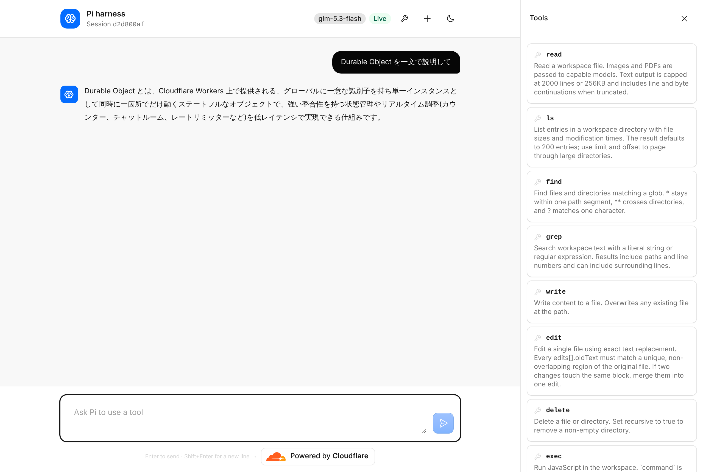
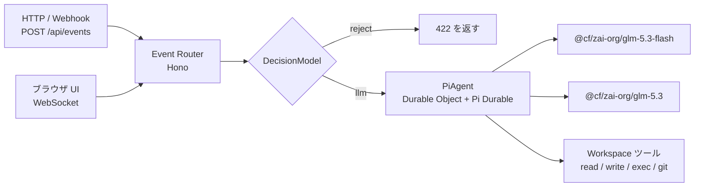

# D1Agents: Pi Durable Agent on Cloudflare

Cloudflare Agents SDK の `PiHarness`（Pi Durable）を使ったエージェントです。
すべてのリクエストは **Event Router（Hono）** から入り、**DecisionModel** が使う LLM を決め、**Pi Durable Agent** が答えます。

- デプロイ先: https://d1agents-pi-durable.itumens.workers.dev
- 元にしたサンプル: [cloudflare/agents `examples/next/harnesses/pi`](https://github.com/cloudflare/agents/tree/main/examples/next/harnesses/pi)
- ドキュメント: [Pi harness](https://developers.cloudflare.com/agents/harnesses/pi/)



## 全体の流れ



| 層 | ファイル | 役割 |
| --- | --- | --- |
| Event Router | `src/router.ts` | Hono で HTTP を受け、イベントの形にそろえる |
| DecisionModel | `src/decision-model.ts` | イベントの意図を判定し、使う LLM を決める |
| PiAgent | `src/server.ts` | Pi Durable を動かす Durable Object。判定結果のモデルを設定して回答する |
| UI 配信（フォールバック） | `scripts/embed-ui.mjs` | UI を Worker に埋め込んで配信する（後述） |

## DecisionModel の判定手順

上から順に試し、最初に決まった段階で終わります。

| 順番 | 段階 | 内容 | `decidedBy` |
| --- | --- | --- | --- |
| 1 | ガードレール | 空文字、8000 文字超、禁止パターンは `reject` | `guardrail` |
| 2 | キーワードルール | 日本語・英語のキーワードで `workspace` / `analysis` を採点し、はっきり勝った方に決める。40 文字以下でキーワードなしは `chat` | `rules` |
| 3 | 小型 LLM 分類器 | `@cf/meta/llama-3.2-3b-instruct` に JSON で意図を答えさせる（5 秒で打ち切り） | `classifier` |
| 4 | フォールバック | 上で決まらなければ `chat` | `fallback` |

意図ごとに使う LLM（`POLICY` を書き換えると変更できます）:

| 意図 | 例 | LLM |
| --- | --- | --- |
| `chat` | 短い質問、雑談 | `@cf/zai-org/glm-5.3-flash` |
| `workspace` | ファイル操作、コード実行、git | `@cf/zai-org/glm-5.3-flash`（ツールあり） |
| `analysis` | 比較、設計、分析 | `@cf/zai-org/glm-5.3` |

## API

| メソッド | パス | 内容 |
| --- | --- | --- |
| GET | `/api/health` | 動作確認と、今のルーティング表 |
| POST | `/api/decide` | DecisionModel だけを実行（LLM は呼ばない） |
| POST | `/api/events` | Router → DecisionModel → Pi → LLM の全体を実行 |
| GET | `/api/sessions/:id/decisions` | そのセッションの判定ログ（新しい順） |
| GET | `/agents/pi-agent/:id` | ブラウザ UI 用の WebSocket |

`/api/events` の入力:

| フィールド | 必須 | 既定値 | 説明 |
| --- | --- | --- | --- |
| `text` | はい | なし | エージェントへの指示 |
| `session` | いいえ | `default` | Durable Object 名。同じ名前なら会話とファイルが続く |
| `id` | いいえ | ランダム | 冪等キー。同じ id は 1 回だけ処理される |
| `source` / `type` | いいえ | `http` / `message` | イベントの出どころ。会話ログに残る |
| `wait` | いいえ | `true` | `false` で受け付けだけ返し、回答はバックグラウンドで進む |

### 試す

判定だけを見る:

```bash
curl -s -X POST https://d1agents-pi-durable.itumens.workers.dev/api/decide -H 'content-type: application/json' -d '{"text":"マイクロサービスとモノリスを比較して"}'
```

LLM まで通す:

```bash
curl -s -X POST https://d1agents-pi-durable.itumens.workers.dev/api/events -H 'content-type: application/json' -d '{"session":"demo","text":"/workspace/haiku.txt に俳句を書いて保存し、読み返して"}'
```

判定ログを見る:

```bash
curl -s https://d1agents-pi-durable.itumens.workers.dev/api/sessions/demo/decisions
```

ブラウザ UI で送ったメッセージも同じ DecisionModel を通り、`source: "websocket"` として記録されます。

## ツールチェーン

| 道具 | 用途 | コマンド |
| --- | --- | --- |
| Vite+ (`vp`) | 開発サーバーとビルド | `pnpm start` / `pnpm build` |
| Hono | Event Router | `src/router.ts` |
| `cf` CLI | Cloudflare リソースの確認・操作 | `pnpm exec cf cli search "<やりたいこと>"` |
| Wrangler | デプロイ | `pnpm run deploy` |
| Vitest 5（Vite+ 経由）+ `@cloudflare/vitest-plugin` | Workers 上のテスト | `pnpm test:workers` |
| Vitest 5（Vite+ 経由）+ happy-dom + Testing Library | React UI のテスト | `pnpm test:ui` |

テストは `vp test` で動かします。`pnpm test` は次の 2 つを順に実行します。

| スイート | 設定ファイル | 実行環境 | 対象 |
| --- | --- | --- | --- |
| Workers | `src/tests/vitest.config.ts` | Workers ランタイム（`@cloudflare/vitest-plugin`、旧 `@cloudflare/vitest-pool-workers`） | `src/tests/*.test.ts` |
| UI | `src/tests/ui/vitest.config.ts` | Node + happy-dom | `src/tests/ui/*.test.tsx` |

UI のコンポーネントは `src/ui/` にあります。`src/client.tsx` はページに `<App />` を描画するだけの入口なので、テストは `src/ui/` を直接 import します。

## ローカルで動かす

```bash
pnpm install
```

```bash
pnpm start
```

Workers AI はリモートのバインディングを使うため、`wrangler login` が必要です。

## デプロイ

通常はこちらです（UI を Workers Static Assets として配信）:

```bash
pnpm run deploy
```

静的ファイルのアップロードができない環境では、UI を Worker に埋め込む方法を使います:

```bash
pnpm run deploy:embedded
```

| 方法 | UI の置き場所 | 使う場面 |
| --- | --- | --- |
| `deploy` | Workers Static Assets | 通常の手元環境、CI |
| `deploy:embedded` | Worker のモジュール（`ui-assets.js`） | プロキシが `Authorization` ヘッダーを書き換える環境 |

`deploy:embedded` が必要になる理由: Static Assets のアップロードは一時的な JWT を `Authorization` ヘッダーで送ります。API トークンを差し込むプロキシを通すと、このヘッダーが置き換わり 401 になります。Worker 本体のアップロードは API トークンで通るので、UI を Worker に含めて配信します。

UI を小さくするため、コードのシンタックスハイライト（`@streamdown/code`）は外しています。これで UI は約 11 MB から約 1.3 MB になりました。コードブロックは色なしの等幅で表示されます。

## 元のサンプルからの変更点

| 項目 | 元のサンプル | このリポジトリ |
| --- | --- | --- |
| 入口 | `fetch` 関数で直接振り分け | Hono の Event Router |
| モデル選択 | 固定（`glm-5.3-flash`） | DecisionModel が毎回決める |
| HTTP からの利用 | なし | `POST /api/events` |
| 判定ログ | なし | Durable Object の SQLite に `router_decisions` テーブル |
| ビルド | Vite | Vite+ |
| `agents` バージョン | `*`（monorepo 内） | `^0.33.0`（Pi 1.5 対応） |
| `@cloudflare/computer` | 0.8（`WorkerJavaScriptBackend`、`ws:git`） | 0.10（`CodemodeBackend`、`codemode:git`） |

Pi harness 本体の設計メモは [`docs/upstream-README.md`](docs/upstream-README.md) と [`docs/upstream-NOTES.md`](docs/upstream-NOTES.md) にあります。Pi は MIT ライセンスです（[`licenses/mit-earendil-pi.txt`](licenses/mit-earendil-pi.txt)）。
