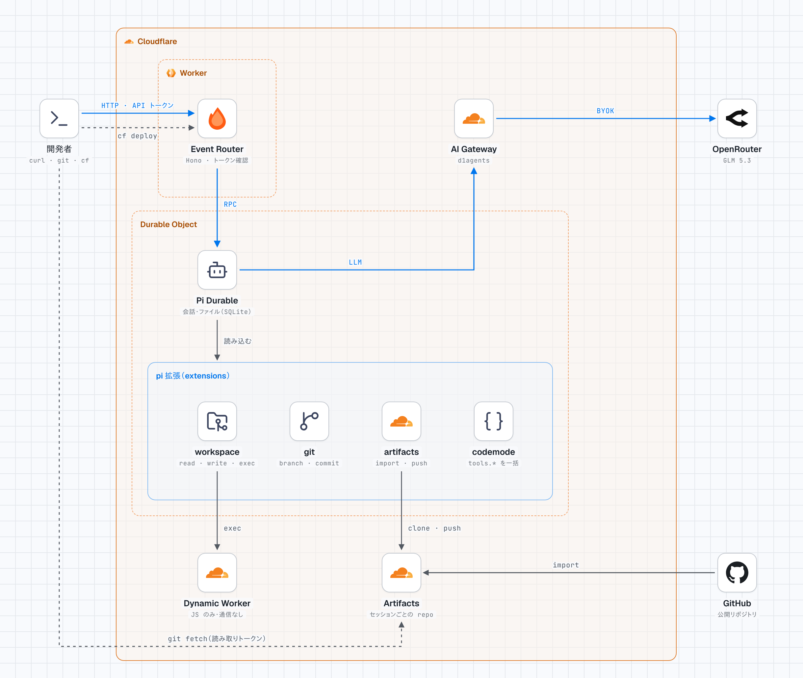
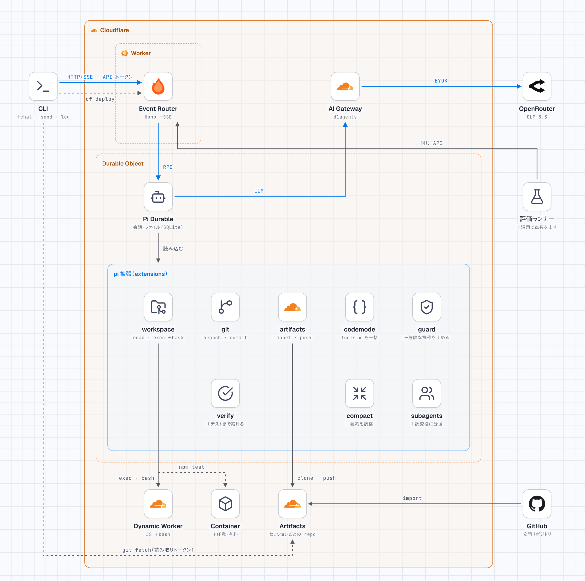

# 構成図：現状と期待値

D1Agents の「いまの構成」と「目指す構成（案）」を並べた図です。図は [stack-diagram](https://github.com/caru-ini/stack-diagram) で作りました。2 枚の図は、同じ部品を同じ位置に置いています。期待値の図で役割の先頭に「＋」があるものが、新しく足す部分です。

基本の考え方は 1 つです。**Pi が動いている間の振る舞いは pi 拡張（extensions）に入れ、外とのつなぎはアプリ側（Worker・Durable Object）に残します。**

| ファイル | 内容 |
| --- | --- |
| `current.html` / `current.png` / `current-dark.png` | 現状 |
| `target.html` / `target.png` / `target-dark.png` | 期待値（案） |

HTML はフォントとロゴを埋め込んだ 1 ファイルなので、ネットワークなしでブラウザで開けます。PNG は HTML をそのまま撮ったものです。

2 枚とも Cloudflare Artifacts に切り替えたあとの構成です。期待値の図では、提案中の拡張（guard・verify・compact・subagents）を pi 拡張の 2 段目に並べています。

## 現状

<picture>
  <source media="(prefers-color-scheme: dark)" srcset="current-dark.png">
  
</picture>

## 期待値（案）

<picture>
  <source media="(prefers-color-scheme: dark)" srcset="target-dark.png">
  
</picture>

## pi 拡張とアプリ側の分担

pi の拡張は、ツール（`tools`）、システムプロンプトの段落（`sections`）、処理の前後への割り込み（`hooks`）、既存のツールの包み直し（`wraps`）、途中から再開できる独自の処理（`tasks`）をまとめたものです。

| 機能 | やり方 | 置き場所 | 状態 |
| --- | --- | --- | --- |
| ガード | `beforeTool` で危険な操作を止める | pi 拡張 | 案 |
| 検証 | `onYield` で「テストが通るまで続ける」 | pi 拡張 | 案 |
| 要約 | `beforeCompact` でコーディング向けに残すものを決める | pi 拡張 | 案 |
| サブエージェント | `tools` と `tasks`。止まっても再開できる | pi 拡張 | 案 |
| Code Mode | スクリプトから自分のツールをまとめて呼ぶ（`createCodemodeExtension`、QuickJS を Durable Object の中で動かす） | pi 拡張 | 済 |
| Workspace ツール | `workspace` 拡張（システムプロンプトと Workspace ツール）。bash と順番実行を足す | pi 拡張 | 済（bash と順番実行は案） |
| 認証・API・SSE | Pi は通信の方法を決めない設計 | アプリ側 | 済（SSE は案） |
| 保存先・起こす仕組み | `PiHarness` が SQLite と alarm を受け持つ | アプリ側 | 済 |

Event Router は、空の依頼と長すぎる依頼だけを Pi に渡す前に断ります。pi 拡張のガードは、Pi の中でツールを実行する直前に止めるものです。

## 現状と期待値の比較

「状態」の意味：

| 状態 | 意味 |
| --- | --- |
| 済 | もう動いている |
| 案 | 提案の段階。やるかどうか、やり方も含めて未定 |

| 分野 | 現状 | 期待値 | 状態 |
| --- | --- | --- | --- |
| 入口 | `curl` と Webhook（`POST /api/events`） | CLI（chat / send / log）と評価ランナーが同じ API を使う | 案 |
| 認証 | アカウント API トークン（Worker が Cloudflare API で確かめる） | 変えない | 済 |
| API | `/api/events`、`/api/decide`、判定ログ、リポジトリの読み取りトークン | セッション単位の prompt / stream（SSE）/ messages / abort | 案 |
| API 設計の進め方 | ー | 試作で Pi の実データを見てから、イベントの形を `docs/api.md` に決める | 案 |
| モデル | OpenRouter の GLM 5.3 に固定（`src/model.ts`） | 変えない | 済 |
| 会話の永続化 | Pi Durable が Durable Object の SQLite に保存 | 変えない | 済 |
| pi 拡張 | `workspace`・`git`・`artifacts`・`codemode` | ガード・検証・要約・サブエージェントを拡張として足す | 案 |
| ファイル操作 | read / write / edit / ls / find / grep | 変えない | 済 |
| コード実行 | `exec`（JavaScript のみ、通信なし） | `exec` を順番に実行し、bash（`WorkerShellBackend`、just-bash）を足す。bash も Dynamic Worker で動く。ライブラリ側ではまだ実験的な機能 | 案 |
| 本物の Linux | なし | Container で `npm install` / `npm test`（任意・費用あり） | 案 |
| git | Artifacts（名前空間 `d1agents`）にセッションごとのリポジトリ。import・作成・branch・commit・`agent/` ブランチへの push | GitHub への反映（GitHub App のコードは削除。必要ならコミット `2fce24f` から戻す） | 済（GitHub は案） |
| 品質の測定 | 単体テスト 16 件 | 評価ランナーで成功率・コスト・時間を記録。拡張のあり・なしも比べる | 案 |
| デプロイ | 手元から `cf deploy`（`cloudflare.config.ts`） | 変えない | 済 |

## 図を作り直すとき

1. stack-diagram のスキル（`npx skills add caru-ini/stack-diagram`）を入れる
2. `current.html` / `target.html` の NODES・GROUPS・EDGES を書き換える。座標のルールはスキルの `references/geometry.md` にあります
3. スキルの `scripts/render_png.py` で、ライトとダークの PNG を作り直す

日本語を含むので、PNG を作る環境には日本語フォント（Noto Sans JP など）が必要です。
