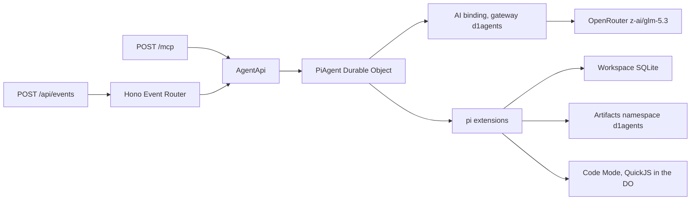
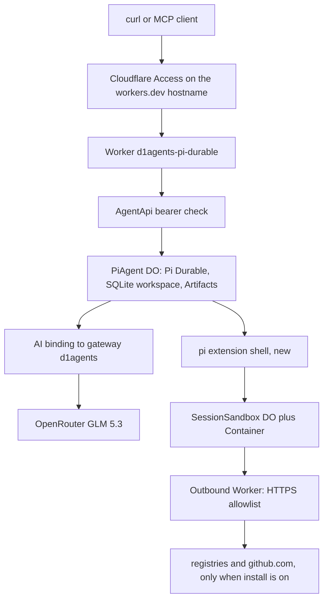

# Sandboxed coding-agent execution

Research and design memo. No feature work is proposed as a code change in this pull request.

Investigated on 2026-11-20 against `claude/pi-durable-agent-deploy-d23tpm` at `14ca33f` (the GitHub default branch). Cloudflare pages were read the same day. Prices below are either from this repo's README or from the Cloudflare pricing page linked in [Cost](#cost). They are estimates for a planning discussion, not a bill.

## Current status

D1Agents is a headless Pi Durable agent. There is no browser UI. One session is one `PiAgent` Durable Object. The conversation and the `/workspace` files live in that object's SQLite, so an eviction can resume.



| Layer         | Where                          | What it does                                                                                                                                                                               |
| ------------- | ------------------------------ | ------------------------------------------------------------------------------------------------------------------------------------------------------------------------------------------ |
| Worker entry  | `src/index.ts`                 | `/mcp` goes to the MCP handler. Every other path goes to Hono. Exports `PiAgent`.                                                                                                          |
| Event Router  | `src/router.ts`                | `GET /api/health`, `POST /api/events`, `GET /api/sessions/:id/repos`. Health skips auth.                                                                                                   |
| Shared intake | `src/agent-api.ts`             | Bearer check, session name `[A-Za-z0-9_-]{1,64}`, non-empty `text` at most 8,000 characters. Routes to `env.PiAgent.getByName(session)`.                                                   |
| MCP           | `src/mcp.ts`                   | Streamable HTTP on `/mcp` via `agents/mcp/server`. Tools `send_event`, `session_repos`, and `health` call `AgentApi`. No OAuth. CORS allows any origin.                                    |
| Model         | `src/model.ts`, `src/agent.ts` | `MODEL_ID` is `z-ai/glm-5.3`. `gatewayOpenRouterProvider()` registers a pi-ai provider named `openrouter` whose streams go through `createAI({ binding: env.AI, id: env.AI_GATEWAY_ID })`. |
| Tools         | `src/extensions/`              | `workspace` (files plus JS `exec`), `git` (`agent/` branches only), `artifacts` (per-session git repos), `codemode` (QuickJS, `models: false`).                                            |

### Model and credentials

The repo's current truth matches the owner's constraint. Commit `0872bd5` removed the decision model and fixed the model to GLM 5.3. The README prices that model on OpenRouter at $0.07 per million input tokens and $1.40 per million output tokens. The OpenRouter key is a provider key on AI Gateway `d1agents` (`AI_GATEWAY_ID` in `cloudflare.config.ts`). The Worker does not hold it. `AI` is `remote: true` in dev, so local `cf dev` still needs `cf auth login`.

`thinkingLevel` is `low`. Retries are on, up to 5, with a 1 second base delay. Code Mode cannot call models (`models: false` in `src/extensions/codemode.ts`), which keeps a script from looping on the model.

`exec` runs an ES module in a Dynamic Worker (`CodemodeBackend`, binding `LOADER`). The module has no network of its own. `codemode:git` is created with `allowNetwork: true`, so the isolate can clone HTTPS git URLs. Push from `exec` is refused by the tool text; the `agent/` rule is enforced in the `git` and `artifacts` extensions, not inside the isolate.

### Auth

If the Worker secret `API_TOKEN` is unset, `AgentApi.authorize` allows the call. The README says that, and `/api/health` reports `auth: "none"`. When the secret is set, `/api/*` except health, and all of `/mcp`, require `Authorization: Bearer`. Comparison hashes both strings with SHA-256. `/api/sessions/:id/repos` also refuses to mint read tokens until `API_TOKEN` is set. The README's secret command is still Wrangler, because this repo treats `cf` as missing a one-secret command:

```bash
pnpm exec wrangler secret put API_TOKEN --name d1agents-pi-durable
```

### Build, lint, test

Checked on this branch after `pnpm install --frozen-lockfile` (pnpm 10.33.4, Node 22.23.4). pnpm skipped dependency build scripts (`esbuild`, `workerd`, and others). The commands below still ran.

| Command                                                                   | Result                                                                                                                                                                                                                                                               |
| ------------------------------------------------------------------------- | -------------------------------------------------------------------------------------------------------------------------------------------------------------------------------------------------------------------------------------------------------------------- |
| `pnpm exec vp test run --config src/tests/vitest.config.ts` (`pnpm test`) | Pass. 6 files, 26 tests, about 15 seconds.                                                                                                                                                                                                                           |
| `pnpm run build` (`cf build`)                                             | Pass. Vite bundle, about 1 second.                                                                                                                                                                                                                                   |
| `pnpm exec cf deploy --dry-run`                                           | Pass. No upload. Bindings reported: `PiAgent`, `ARTIFACTS` (`d1agents`), `AI`, `AI_GATEWAY_ID` (`d1agents`), `LOADER`. Upload size about 6.1 MiB / gzip 1.5 MiB.                                                                                                     |
| `pnpm run typecheck` (`cf workers types && tsc --noEmit`)                 | Pass.                                                                                                                                                                                                                                                                |
| `pnpm exec vp check --no-fmt`                                             | Pass. No lint warnings in 24 files.                                                                                                                                                                                                                                  |
| `pnpm exec vp check`                                                      | Fail. Oxfmt reports 21 existing files (README, source, HTML diagrams, `package.json`, configs). A sample diff is markdown table alignment, key order in `package.json`, and trailing commas in TypeScript. No logic change. This memo does not reformat those files. |

The README still says 25 tests. The suite on this commit is 26. Tests run in the Workers runtime through `@cloudflare/vitest-plugin`, which still reads `src/tests/wrangler.jsonc`. That file is the test harness config, not the deploy config. Production config is `cloudflare.config.ts`. Toolchain versions on this commit: `cf@1.0.0-beta.27`, `@cloudflare/vite-plugin@2.0.0-beta.v.12`, `vite-plus` catalog `1.5.0`, `vitest` catalog `5.1.0`, Wrangler locked at `4.158.0`.

`vp check` is the lint-and-format gate. The Worker build is `cf build`, not a Vite+ build script.

### Deploy evidence

There is no deploy workflow. `.github/` contains only `dependabot.yml`. The only GitHub Actions workflow on the repo is Dependabot Updates. Deploy is documented as a local `pnpm run deploy`, which is `cf deploy`. A dry run packages the Worker. It does not prove the remote resources.

The hostname in the README, `https://d1agents-pi-durable.itumens.workers.dev`, answers. On 2026-11-20, `GET /api/health` returned `302` to a Cloudflare Access login on `cloud-omp.cloudflareaccess.com`, with `www-authenticate: Cloudflare-Access`. That is evidence a Worker is deployed on that hostname and that Access sits in front of at least `/api/health`. This probe had no Access session, so it did not see the health JSON, the model string, or whether `API_TOKEN` is set. Other paths were not probed. Access is not in `cloudflare.config.ts`. It is account configuration, which is the right place for it, and it is invisible to a reader of the public repo.

What a deploy needs today, from the README and `cloudflare.config.ts`:

- `cf auth login` (cf does not reuse a Wrangler login).
- Workers Paid, already required for Artifacts. The README says Artifacts billing starts 2026-11-12, with 10,000 operations and 1 GB included.
- AI Gateway `d1agents` with an OpenRouter provider key. The Worker only has the gateway id.
- `API_TOKEN` stored as a Worker secret if the API should be closed. `.dev.vars` is gitignored.
- No static assets. `observability.enabled` is true. Traces are not enabled.

A container deploy adds more, in [cf equivalents](#cf-cli-equivalents). The official runner tutorials also require a local Docker daemon at image-build time. This branch's `cf` can express a container, but no container has been deployed from this repo.

### Branch split that affects the Dependabot PRs

GitHub's default branch is `claude/pi-durable-agent-deploy-d23tpm`. Dependabot is configured with `target-branch: main`. Those branches have diverged:

- Default branch `14ca33f` is the agent this memo describes (Artifacts, Code Mode, MCP, GLM 5.3, `cf@1.0.0-beta.27`). It does not contain `main`.
- `main` at `4f0d493` is mostly older history plus Dependabot PR #7, which bumped Cloudflare tooling to `cf@1.0.0-beta.28`. That commit is not on the default branch.

Merging a PR into `main` does not update the branch this repo runs from. The four open PRs would need a rebase onto the default branch before they apply to this code.

### Open Dependabot PRs #9–#12

All four were opened by Dependabot on 2026-11-16, target `main`, and are not drafts. There is no test workflow, so none of them have CI. They were not checked out or tested for this memo. "Safe" here means the diff is a dependency bump with no surprise code, and the changelog does not obviously break the agent's security rules. It does not mean the suite was run.

| PR                                                        | Change                                                                                                                                                                                                                               | Verdict                                                                                                                                                                                                                                                                                                                                                                                                                                                                                                                                                                            |
| --------------------------------------------------------- | ------------------------------------------------------------------------------------------------------------------------------------------------------------------------------------------------------------------------------------ | ---------------------------------------------------------------------------------------------------------------------------------------------------------------------------------------------------------------------------------------------------------------------------------------------------------------------------------------------------------------------------------------------------------------------------------------------------------------------------------------------------------------------------------------------------------------------------------- |
| [#9](https://github.com/YuSa0-6/PiDurableAgents/pull/9)   | `@cloudflare/computer` `0.10.0` to `0.11.2` (`package.json` and the lockfile).                                                                                                                                                       | Do not merge on the changelog alone. This is a minor of the library that implements `exec` and git. 0.11.0 adds experimental `remote-exec` (a container command, with workspace files pushed in and pulled back) and 0.11.1 adds `fetch`, `pull`, and `push` on `codemode:git`. The `agent/` push rule lives in the pi extensions. A new `push` inside the isolate can skip it if the isolate can see a credential. Review that before merging. The remote-exec work is relevant to the design below, and it should be evaluated on its own rather than taken as a drive-by minor. |
| [#10](https://github.com/YuSa0-6/PiDurableAgents/pull/10) | Catalog `vite-plus` `1.5.0` to `1.6.0`. `vite` stays on `@voidzero-dev/vite-plus-core@1.5.0` and `vitest` stays on `5.1.0`, because Dependabot ignores those.                                                                        | Low security risk. Real chance the 1.6 CLI disagrees with the pinned core. `vp check` already fails format on 1.5.0, so a formatter bump will be noisy. Run `vp check` and `vp test` after a rebase.                                                                                                                                                                                                                                                                                                                                                                               |
| [#11](https://github.com/YuSa0-6/PiDurableAgents/pull/11) | Dev tooling: `@cloudflare/vite-plugin` beta 12 to beta 16, `@cloudflare/vitest-plugin` 1.6.0 to 1.8.1, `cf` 1.0.0-beta.28 to beta.31, `wrangler` to `^4.161.0`. The patch's base is `main`. This branch is still `cf@1.0.0-beta.27`. | Low security risk. Highest chance of changing `cf` config types and the Workers test runner. Rebase onto the default branch and rerun `vp test`, `cf build`, and `pnpm run typecheck`. Beta.31 is also the CLI most likely to match the current container docs.                                                                                                                                                                                                                                                                                                                    |
| [#12](https://github.com/YuSa0-6/PiDurableAgents/pull/12) | `@earendil-works/*` `1.5.0` to `1.5.2` (inside the existing `~1.5` pin) and `hono` `4.13.16` to `4.13.18`. Lockfile only besides the ranges.                                                                                         | The safest of the four. Patch-level, no application diff. Still run the suite after a rebase onto the default branch. Hono is the Event Router, so a patch can still change HTTP behavior.                                                                                                                                                                                                                                                                                                                                                                                         |

## What Cloudflare documents

Two different products are easy to mix up.

**A Linux sandbox for an agent that already has a loop.** [Agents SDK: Sandbox](https://developers.cloudflare.com/agents/tools/sandbox/) attaches a Container to a Durable Object. The model gets a tool such as `run_command`. The loop, the transcript, and the credentials stay in the object. The container cannot read the object's storage, environment, or bindings. It has no internet until the Worker allows it. Files in the container disappear when the container stops, unless a snapshot is restored. The [harness concept](https://developers.cloudflare.com/agents/concepts/harness/) says to keep the loop in the Durable Object when you can: if the container dies, one tool call fails and the run continues.

**A coding-agent CLI whose loop runs inside the container.** [Coding agents overview](https://developers.cloudflare.com/sandbox/coding-agents/) and [the runner tutorial](https://developers.cloudflare.com/sandbox/get-started/build-a-coding-agent-runner/) build a Worker that clones a GitHub repo, runs Claude Code, Codex, OpenCode, or the Pi CLI, and returns a diff. The Worker holds the gateway token and adds it on the way out. The sandbox is allowed to reach the gateway and `github.com` only. A second group (Devin, Cursor, Claude Managed Agents, OpenAI Agents API) runs the loop in the vendor's cloud and uses the container as an executor. In the Devin, Cursor, and OpenAI templates, that executor process holds a vendor credential.

This repo is already the first shape, without the Linux container. `docs/architecture/README.md` already marks "Container for `npm install` / `npm test`" as a proposal and marks the model as staying GLM 5.3. That diagram and this memo agree. Replacing Pi Durable with a vendor CLI would conflict with both.

### Codex CLI

[Guide](https://developers.cloudflare.com/sandbox/coding-agents/codex/). The container runs `codex exec` from `@openai/codex`. Requests use the OpenAI Responses API against the gateway's `/openai` path. The documented model is an OpenAI model (`gpt-6-sol` in the guide). A custom provider sends no API key. The Outbound Worker adds `cf-aig-authorization`. The container is started with `--dangerously-bypass-approvals-and-sandbox`, so the container network policy is the only sandbox.

Fit: poor, unless the owner opts into an OpenAI model. GLM 5.3 on OpenRouter is not a Responses-API OpenAI model. This would be a second agent, with its own session, next to Pi Durable. It does match the "credentials stay in the Worker" pattern.

### OpenAI Agents API

[Guide](https://developers.cloudflare.com/sandbox/coding-agents/openai-agents-api/). OpenAI runs the Codex loop. The Worker receives signed webhooks (`agent.session.created`, `action_required`, `in_progress`, `idle`, `failed`). A Durable Object per session starts a container running `codex exec-server`. The executor connects out with a restricted API key that is placed in the container as `CODEX_API_KEY`. The guide says every process in the container can read it. Internet is on so the executor can reach OpenAI, which means every command the agent runs has that network too, unless an outbound handler is added. The template is Wrangler, needs a public `/webhook` that Access must not intercept, and uses OpenAI models (`gpt-5.6-sol` in the sample).

Fit: reject under the current constraints. It is an OpenAI-only control plane. It puts a raw key in the sandbox. The live hostname is already behind Access, and the guide requires `/webhook` to be reachable without an interactive Access login. Opening that path on a public-repo Worker is a new unauthenticated entry point, even with signature checks.

### Claude Code

[Guide](https://developers.cloudflare.com/sandbox/coding-agents/claude-code/), and the same binary in the runner tutorial. `ANTHROPIC_BASE_URL` points at the gateway's `/anthropic` path. The documented model is `claude-sonnet-5`. The CLI gets a placeholder `ANTHROPIC_API_KEY`. Outbound must delete `x-api-key` before adding the gateway token, or Anthropic rejects the request. Permissions are skipped inside the container.

Fit: poor unless the owner opts into Anthropic. Same "second agent" problem as Codex. The credential pattern itself is sound.

### OpenCode

[Guide](https://developers.cloudflare.com/sandbox/coding-agents/opencode/). OpenCode is the only CLI in this set whose model id is provider-qualified (`cloudflare-ai-gateway/anthropic/claude-sonnet-5` in the guide). It uses a built-in gateway provider, a placeholder `CLOUDFLARE_API_TOKEN`, and the same Outbound rewrite. The guide's prerequisite is still Anthropic credentials in the gateway. The pinned binary has its own model list. The guide tells you to print it with `opencode models cloudflare-ai-gateway`. `z-ai/glm-5.3` is not shown there. OpenCode also tries to install `@opencode-ai/plugin` from npm. The runner's allowlist answers that with 403, and the process continues.

Fit: the least bad CLI, and still a poor default. Pointing it at `https://gateway.ai.cloudflare.com/v1/{account}/d1agents/openrouter` with a placeholder key rewritten by Outbound is an adaptation, not what the guide ships. It would need a proof that this OpenCode build can call `z-ai/glm-5.3` with tool use. It would also duplicate the Pi Durable session, the `agent/` push rules, and Artifacts.

### Pi CLI in a sandbox

The overview also has a [Pi guide](https://developers.cloudflare.com/sandbox/coding-agents/pi/) that this task did not list and that matters because the project is already Pi. It runs `@earendil-works/pi-coding-agent@0.87.1` with `--provider cloudflare-ai-gateway`. The documented prerequisite is Anthropic credentials, and the sample model is `claude-sonnet-5`. The guide warns that Pi 0.87.1 asks Workers AI for as many output tokens as the context window. The env var `CLOUDFLARE_API_KEY` is a placeholder that Outbound replaces.

Fit: conflicts with this repo even though the name matches. This repo uses `@earendil-works/pi-durable` and `pi-ai` at `~1.5.0`, inside a Durable Object, with a custom provider that forces the AI binding. The sandbox guide is a different package line (0.87 versus 1.5) and a different credential path (gateway token header versus the AI binding, which holds no key). Running both would split sessions and tool policy.

### Agents SDK sandbox, which is the matching option

[Sandbox](https://developers.cloudflare.com/agents/tools/sandbox/) is the option that fits the owner constraints without an extra opt-in.

- The loop stays in `PiAgent`. Model calls stay on the existing AI binding and gateway `d1agents`. The container never calls a model, so it never needs a gateway token, an OpenRouter key, or a placeholder key.
- The container is for Linux: a shell, `npm`, compilers, tests. That is the "本物の Linux" row already marked as a proposal in `docs/architecture/README.md`.
- `enableInternet: false` is the documented default. An outbound handler is how you add a hostname later, and how you would attach a credential after the request leaves the container. This design does not need the second part for model calls.
- Code Mode stays the fast path for "call my own tools." The Agents docs say the same thing: if the script only calls methods you define, use Code Mode, because a Dynamic Worker starts faster than a container.

`@cloudflare/computer` 0.11 `remote-exec` (PR #9) is a library-shaped version of the same idea: `exec` in the workspace pushes files into a container and pulls them back. It is marked experimental upstream. It is a reasonable spike. It is not a reason to skip the egress and credential rules below, and the same release widens `codemode:git`.

## Comparison

| Option                                           | OpenRouter via `d1agents`                                                                                         | Cost shape                                                                                                                  | Complexity against this repo                                                                                                                   | Security                                                                                                                                                              |
| ------------------------------------------------ | ----------------------------------------------------------------------------------------------------------------- | --------------------------------------------------------------------------------------------------------------------------- | ---------------------------------------------------------------------------------------------------------------------------------------------- | --------------------------------------------------------------------------------------------------------------------------------------------------------------------- |
| Codex CLI in a sandbox                           | No. OpenAI Responses API only. Needs an owner opt-in.                                                             | Container plus an OpenAI model. Frontier models are a different bill from GLM 5.3. Re-price before enabling.                | New Worker, Dockerfile, second session store, Wrangler tutorial to translate to `cf`. Ignores Pi extensions, Artifacts, and the `agent/` rule. | Gateway token stays in the Worker. CLI runs with approvals off. Egress is gateway plus `github.com`.                                                                  |
| OpenAI Agents API                                | No. OpenAI hosts the loop and the model.                                                                          | OpenAI token bill plus a container per session, snapshots on idle.                                                          | Webhooks, two API keys, executor image, public webhook URL. Does not use Pi Durable.                                                           | Executor key is inside the container. Commands share the executor's network. Access in front of this hostname blocks the webhook unless a path is opened.             |
| Claude Code                                      | No. Anthropic endpoint only.                                                                                      | Same as Codex, with Anthropic prices.                                                                                       | Same runner as the tutorial. Second agent.                                                                                                     | Placeholder key, Outbound rewrite. Approvals skipped. Reads `CLAUDE.md` from a cloned repo.                                                                           |
| OpenCode                                         | Not as documented. The guide uses Anthropic through the gateway. An OpenRouter base URL is unproven with GLM 5.3. | Container plus whatever model the binary actually calls.                                                                    | Same runner, plus a model-list check on the pinned binary. Still a second agent.                                                               | Placeholder token, Outbound rewrite. It tries to reach npm. `--auto` approves tool calls.                                                                             |
| Pi CLI (`pi-coding-agent` 0.87)                  | Not as documented. Built-in gateway provider, Anthropic sample model. Different package from `pi-durable` 1.5.    | Container plus that model's bill.                                                                                           | Two Pi stacks and two session files.                                                                                                           | Placeholder key, Outbound rewrite. Tools run without an approval prompt. Loads `AGENTS.md` / `CLAUDE.md` from the repo.                                               |
| **Sandbox as a tool of `PiAgent` (recommended)** | Yes. No change to `src/model.ts`. Container does not see the model.                                               | GLM bill as today, plus a container that can stay inside the Workers Paid included amounts if it sleeps. See [Cost](#cost). | One new Durable Object, a pi extension, file sync, an allowlist. Keeps Artifacts and the `agent/` rule.                                        | No model key in the sandbox. Internet off until a registry is allowed. New risk is shell plus prompt injection, which the guard extension does not exist to stop yet. |

## Recommendation

Give `PiAgent` a Linux container as a tool. Do not move the agent loop into Codex, Claude Code, OpenCode, the Pi CLI, or the OpenAI Agents API.

The container is a second Durable Object, one per session name, not a second brain. `PiAgent` keeps the transcript, the workspace SQLite, Artifacts, and the model call. The container runs commands and is disposable. That matches the harness doc: a dead container fails one tool call, and the run continues. Putting the container on `PiAgent` itself would also work with `this.ctx.container`, and it is fewer classes. A separate object is the better first cut because a container restart, a snapshot, and a long `npm test` should not block the chat object's input gate more than a single RPC already does. Code Mode already notes that a long script stalls other turns, including abort.



What crosses the boundary:

- Into the container: a command argv, a timeout, and a copy of the workspace files for that command. No `API_TOKEN`, no OpenRouter key, no gateway token, no Artifacts token in the environment.
- Out of the container: exit code, capped stdout and stderr, and files the tool declared. `redacting()` in `src/extensions/git.ts` replaces exact strings passed in its `secrets` argument. Every secret the Worker injected for that command must be in that list. It does not detect other token-shaped text, so a command that prints a different credential still returns it to the model.
- Model traffic never enters the container. It stays on `env.AI`.

Default network is off (`enableInternet: false` in the Agents sandbox example). Package installs are a later, explicit allowlist. Do not start from the runner tutorial's allowlist of "the whole gateway plus github.com", because this container does not need the gateway, and a broad gateway path would let a command hit every provider behind `d1agents`.

Instance size: use `basic` (1 GiB, 1/4 vCPU, 4 GB disk) for the spike, not `lite` (256 MiB). The cf docs example uses `lite`, which is too small for Node. Move to `standard-1` (4 GiB) only if `npm` runs out of memory. Cap `maxInstances` to a small number so one session cannot fan out. On the `cf` pinned here, `instanceType` and `maxInstances` are fields of the non-DO container schema. The Durable Object form is a different object. See the next section before copying a snippet.

Inactivity timeout should be short, on the order of one to two minutes after the last command. The Agents example uses 10 minutes so files survive the next turn. That is convenient and it is also how a quiet session keeps billing. Artifacts, not the container disk, is the durable copy.

Snapshots are in public beta and are not billed during the beta ([Containers pricing](https://developers.cloudflare.com/containers/pricing/)). They restore files, not processes. Do not make them the source of truth. A crash between snapshot and the next command loses the delta. Commit back to the workspace and to Artifacts under the existing `agent/` rule.

### cf CLI equivalents

Official templates use Wrangler. This repo must not. `cloudflare.config.ts` is the config, and `pnpm run deploy` is the deploy. The `cf@1.0.0-beta.27` installed on this branch already exports `defineContainer` from `cf/config` (via `@cloudflare/config@0.29.1`). The public cf docs fetched the same day show a slightly newer shape. Implement against the CLI version you will actually deploy, and regenerate types. PR #11 (cf beta.31, and only on `main` today) is the likely point where the installed types and the public docs meet.

Wrangler in the runner tutorial:

```jsonc
{
  "containers": [
    {
      "class_name": "AgentSandbox",
      "scheduling_policy": "durable_object",
      "images": { "agent": { "dockerfile": "./Dockerfile" } },
    },
  ],
  "durable_objects": {
    "bindings": [{ "class_name": "AgentSandbox", "name": "SANDBOX" }],
  },
}
```

The same idea on this branch's `cf` types is a Durable Object schedule plus a string name on the export. `schedulingPolicy` is `"durable-object"` (hyphen), not Wrangler's `durable_object`. `instanceType` is not on this variant in beta.27. Confirm the instance size at `start()` time or after a cf upgrade, rather than assuming the docs example's `instanceType: "lite"` applies.

```ts
import { defineConfig, defineContainer, exports } from "cf/config";

const sessionSandbox = defineContainer({
  name: "d1agents-session-sandbox",
  schedulingPolicy: "durable-object",
  images: {
    sandbox: { dockerfile: "./sandbox/Dockerfile" },
  },
});

// Inside worker.exports, next to PiAgent:
// SessionSandbox: exports.durableObject({
//   storage: "sqlite",
//   container: "d1agents-session-sandbox",
// }),
```

The current public docs instead pass the container object into `exports.durableObject({ container })` and set `instanceType` beside `image`. Treat that as the beta.31-era shape until `cf workers types` says so. Do not mix the two.

| Wrangler tutorial                      | This repo                                                                                                                                                                                                                                                                                                          |
| -------------------------------------- | ------------------------------------------------------------------------------------------------------------------------------------------------------------------------------------------------------------------------------------------------------------------------------------------------------------------ |
| `npx wrangler deploy`                  | `pnpm run deploy` (`cf deploy`). `cf deploy --dry-run` builds and does not upload.                                                                                                                                                                                                                                 |
| `containers` plus a DO migration       | `defineContainer()` in `containers`, and `exports.durableObject({ storage: "sqlite", container })`. `cf migrate` does not convert container config.                                                                                                                                                                |
| `wrangler secret put AI_GATEWAY_TOKEN` | Not needed for the recommended design. Model calls stay on the AI binding. Keep using the existing Wrangler one-secret flow for `API_TOKEN` until `cf` grows a single-secret command. `cf deploy --secrets-file` exists in the current cf docs. The file must stay out of git. Do not commit one to a public repo. |
| `npx wrangler types`                   | `pnpm types`                                                                                                                                                                                                                                                                                                       |
| `vars` / `secrets.required`            | `bindings.text()` / `bindings.secret()`                                                                                                                                                                                                                                                                            |
| Image rollout                          | `cf deploy --containers-rollout immediate\|gradual\|none`. `cf workers versions create` prepares images and does not apply container applications.                                                                                                                                                                 |

`ssh.enabled` exists on the container schema. Leave it off. A model-controlled container with SSH keys in a public repo is an unnecessary entry point.

Tests can keep `src/tests/wrangler.jsonc` for the vitest plugin. New production config goes in `cloudflare.config.ts` only.

The runner's Docker requirement is real for the Wrangler path: the tutorial says `wrangler deploy` builds the image and Docker must be running. Confirm the same for `cf deploy` on the chosen beta before the first real rollout. A dry run of today's Worker does not build a container image.

## Cost

Workers Paid is $5 per month and is already required for Artifacts. Container rates below are from [Containers pricing](https://developers.cloudflare.com/containers/pricing/), fetched 2026-11-20. Included each month on Workers Paid: 25 GiB-hours memory, 375 vCPU-minutes, 200 GB-hours disk, and 1 TB of egress in North America and Europe. Past that: memory $0.0000025 per GiB-second ($0.009 per GiB-hour), CPU $0.000020 per active vCPU-second, disk $0.00000007 per GB-second ($0.000252 per GB-hour). Memory and disk are billed on the provisioned size while the instance is running. CPU is billed on active use. Sleep stops the meter. Snapshots are free during the public beta.

`basic` is 1 GiB, 1/4 vCPU, 4 GB disk. `standard-1` is 4 GiB, 1/2 vCPU, 8 GB disk.

| Usage                                                                                             | Container math                                                                                                                         | Extra container cost                 |
| ------------------------------------------------------------------------------------------------- | -------------------------------------------------------------------------------------------------------------------------------------- | ------------------------------------ |
| Realistic: 20 tasks a week, each awake 10 minutes, CPU busy 3 minutes at the `basic` cap.         | About 14 hours awake a month. Memory 14 GiB-hours, disk about 58 GB-hours, CPU about 65 vCPU-minutes. All inside the included amounts. | About $0 on top of Workers Paid.     |
| Heavy but still one developer: 40 hours a week awake on `basic`, CPU busy a quarter of that time. | About 173 hours a month. Memory overage about $1.33, disk about $0.12, CPU about $0.33.                                                | About $2 a month.                    |
| One `standard-1` left running all month, CPU idle.                                                | Memory about $26, disk about $1.40.                                                                                                    | About $27 a month, about $6 a week.  |
| One `standard-1` with the CPU saturated all month.                                                | Add about $26 of CPU.                                                                                                                  | About $53 a month, about $12 a week. |

A forgotten always-on `basic` is a few dollars a week, not $50. The way to blow the container budget is many sessions that each hold a warm `standard-*` instance, or `maxInstances` left unbounded. Sleep, one container per session, and a small `maxInstances` are the controls. Egress for ordinary `npm` installs sits inside the 1 TB allowance.

Model cost dominates, and it stays on GLM if this recommendation is followed. Using the README rates:

- A light week, 30 sessions, 15 calls, 25k input and 2k output tokens each: about $0.79 input and $1.26 output, about $2.
- A heavy week, 50 tasks, 40 calls, 80k input and 8k output: about $11 input and $22 output, about $34.
- About 35 million output tokens in a week is $49. That is a runaway, not a normal week. Output is twenty times the input price.

The $50 per week cap is plausible for GLM at those rates, including a container that sleeps. It is not a safe assumption for the Anthropic and OpenAI models named in the Codex, Claude Code, and Agents API guides. Those rates are not in this repo. Re-quote them before any opt-in. Nothing in the repo enforces the cap. AI Gateway logs are the place to see spend. An alert or a hard stop is an open question.

Durable Object and Workers request charges for this volume are small next to either a runaway model loop or an always-on `standard-1`. They are not itemized here.

## Security, including the public repo

The GitHub repo `YuSa0-6/PiDurableAgents` is public. The Worker name, the gateway id `d1agents`, the Artifacts namespace, the route table, the session-name pattern, the `agent/` branch rule, and the fact that auth is optional until `API_TOKEN` is set are all in the README. That is acceptable for source. It is a bad default for a Linux sandbox.

Implications:

- Anyone who can call the Worker can name any session (`getByName`). Session names are not a secret. With auth off, `POST /api/events` and MCP `send_event` reach any session and can drive its workspace. `AgentApi.repos()` returns 403 before `shareRepos()` when `API_TOKEN` is unset, so that route does not mint Artifacts read tokens for an anonymous caller. Access on the hostname is an extra gate the code does not know about. It is not a substitute for `API_TOKEN`, because an Access service token or a path bypass would still hit an open Worker. A sandbox must not ship while production can run with `auth: "none"`.
- A shell tool plus a public route is a general-purpose computer on the owner's account. Prompt injection from a README, an imported git repo, or a package script matters more once the tool can run `bash`. The guard extension in the target diagram is still a proposal. Until it exists, the first shell should be a short argv allowlist (`npm test`, `vp test`, `git status`, `git diff`), not `bash -lc` of model text.
- The container must not receive raw keys. Do not bake secrets into the Dockerfile. The Dockerfile will be public. Do not copy Artifacts tokens or `API_TOKEN` into the container environment. If git inside the container needs a token, the Worker should attach the short-lived Artifacts token the extension already mints and revokes, and pass that exact value to `redacting()` so the output scrub is limited to secrets it injected.
- Egress default is deny. When install is allowed, name hosts (`registry.npmjs.org`, `github.com`, `objects.githubusercontent.com`, `pypi.org`, `files.pythonhosted.org`), HTTPS only. Do not allow the AI gateway host from the container. Do not allow a generic proxy. The allowlist will be public, which is fine if it is short. An attacker who can run commands will know it.
- `codemode:git` already has `allowNetwork: true` inside the Dynamic Worker. A container allowlist does not close that path. Import of a public HTTPS repo is an existing feature. Widening it is out of scope for the sandbox.
- MCP has no OAuth, CORS is `*`, and the client holds a static bearer token. A leaked token is full control of every session. A sandbox increases the blast radius from "spend GLM tokens and write Artifacts" to "run Linux and talk to the allowlist." Prefer not to put the sandbox tool on the MCP surface until the owner asks.
- Tool output is untrusted. A file or a package can print instructions for the model. The Agents sandbox page says to check tool results before acting outside the sandbox, and to require approval for side effects. Push stays on `repo_push`, which only allows `agent/` branches. The container should not have its own remote credentials.
- Cloudflare Access in front of the hostname is a useful second layer and it is not described in the README. Keep it. Do not punch a hole for a vendor webhook as part of this work. Confirm whether the Access app is the whole hostname or only some paths before relying on it for a new route.
- Container logs go to Workers Logs when observability is on. Commands can echo file contents. Treat logs as sensitive, and do not turn on verbose container logs by default.

## Incremental plan

Each step is shippable on its own and keeps the model path unchanged. Lint and tests stay on `vp`. Config stays on `cf`.

1. **Close the open-auth hole in production before any container.** Require `API_TOKEN` for `/api/events` and `/mcp` on the deployed Worker. Keep Access on the hostname. Document both layers in the README, including that health is open in code and gated by Access in production. Local `.dev.vars` can stay optional for tests.
2. **Spike a container with no network and no model.** Add `SessionSandbox` as its own Durable Object, `basic` or the smallest size the chosen `cf` schema will actually start, `maxInstances` 1, internet off, inactivity timeout under two minutes. A dev-only or test-only call runs `echo` and `git --version`. Image is Debian or the `cloudflare/debian-trixie` image the Agents docs use, with git and Node, no API keys. `cf deploy --dry-run` first. A real deploy needs the Docker question answered.
3. **File sync, still offline.** Copy the session workspace into the container for one command and copy declared outputs back. Do not share SQLite with the container. The Agents docs are explicit that workspace tools and the container do not see each other's files. Cap stdout and stderr. Timeout the process and its children. Pass every secret injected for that command to `redacting()` so those exact strings are removed from the output. If the `@cloudflare/computer` 0.11 `remote-exec` spike does this sync cleanly, prefer it to a hand-rolled copy, after the `codemode:git` push review. Do not merge PR #9 just to obtain it.
4. **pi extension, allowlisted commands.** A new extension, next to `workspace`, exposes something like `test` rather than a free shell. `replay: "unsafe"`. The extension calls `SessionSandbox` by the same session name. `repo_push` and the `agent/` rule stay where they are. Code Mode can call the new tool and inherits the allowlist, which the existing Code Mode tests already expect for push.
5. **Registries, off by default.** An outbound handler allows HTTPS to a written host list only when the command is an install. Plain HTTP is 403, matching the runner tutorial's reason: a downgrade must not carry a header you later add. Still no gateway host.
6. **Measure, then consider a general shell.** Record container awake time, CPU, and the gateway's token totals for a week against the $50 cap. Only then decide whether `bash -lc` is acceptable, and only with the guard extension or an approval step. Snapshots are optional at this point, for warm `node_modules`, not for source.

Tests: extend the Workers vitest suite with a fake sandbox stub for the extension (allowlist, redaction, refusal when `API_TOKEN` is unset). A real container does not run in the current vitest config. `cf dev` is the manual check, the same split the README already uses for real Artifacts clone and push.

## Open questions for the owner

1. Is the sandbox for `npm test` / `vp test` only, or do you want a general shell in the first release? This memo assumes test-only until the guard exists.
2. Is the $50 per week cap OpenRouter plus Cloudflare, and where should it be enforced? The repo has no budget control. Gateway logs show requests. They do not, by themselves, stop a loop.
3. Should production refuse to boot the shell tool when `API_TOKEN` is unset, even if Access is in front? This memo says yes.
4. Is Cloudflare Access meant to cover the whole hostname, including a future sandbox route and `/mcp`? The 2026-11-20 check only saw `/api/health`. Are Grok or other MCP clients using an Access service token today?
5. Will the machine that runs `cf deploy` have Docker? The Wrangler tutorials need it to build the image. It is not confirmed for `cf@1.0.0-beta.27`.
6. Upgrade `cf` (PR #11, rebased onto the default branch) before the container work, so `instanceType` and the Durable Object container form match current docs? This branch's types split those fields.
7. One container per session, destroyed on a short idle, or one per task? Per session is the better fit for a follow-up `npm test`. It costs more if the idle timeout is long.
8. Is experimental `remote-exec` in `@cloudflare/computer` 0.11 acceptable, given that the same minor adds `push` on `codemode:git`?
9. Which registries, if any, may the sandbox reach? This memo starts with none.
10. Dependabot targets `main`, and the default branch is not `main`. Should that config change before the next weekly run, so #9–#12 are rebased onto the branch you actually deploy?
